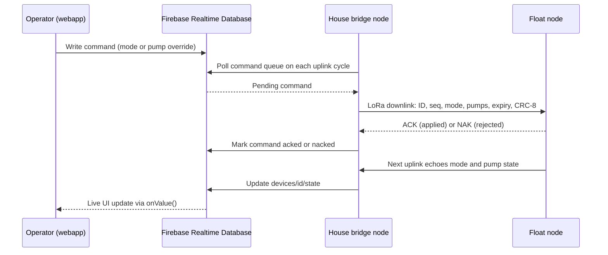
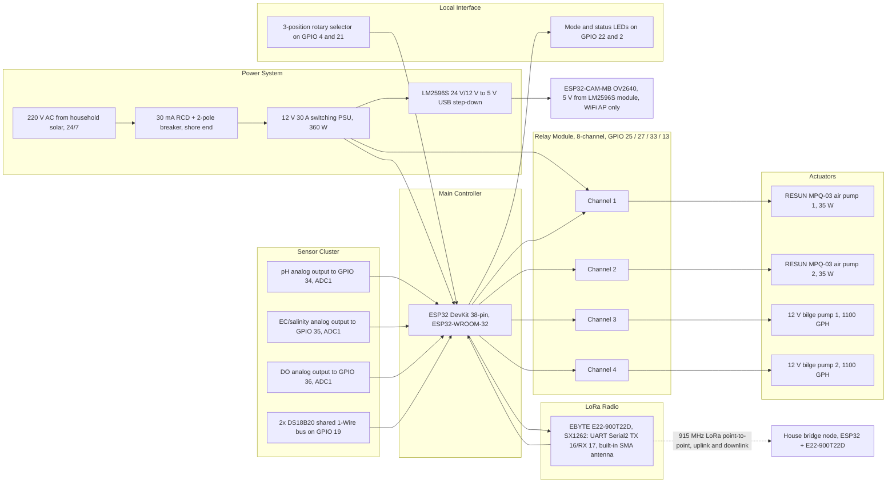
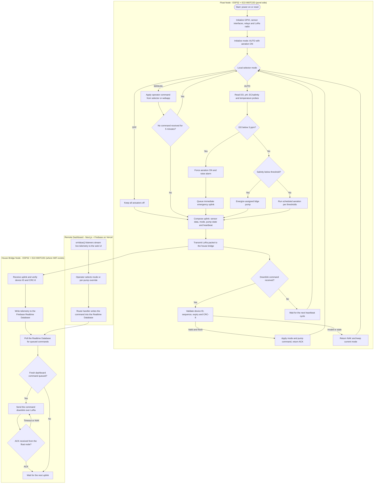
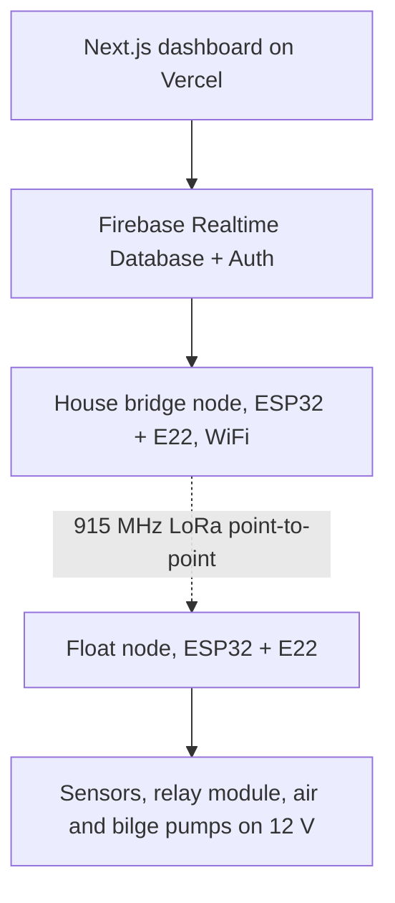
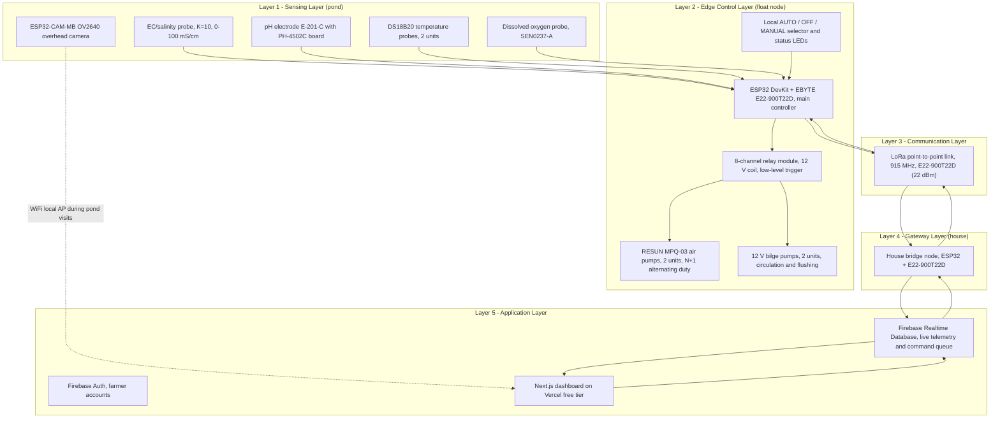

# qppd - crab-grid-smart-aeration

## Structure

```text
crab-grid-smart-aeration/
├── docs/
|   ├── APP.md
|   ├── BLOCK-DIAGRAM.md
|   ├── BOM.md
|   ├── CALIBRATION.md
|   ├── CHANGELOG-LORA-MODULE-UPDATE.md
|   ├── Components.md
|   ├── FIRMWARE.md
|   ├── FLOWCHART.md
|   ├── SETUP.md
|   ├── STACKS.md
|   ├── SYSTEM-ARCHITECTURE.md
|   ├── TESTING.md
|   ├── TROUBLESHOOTING.md
|   └── WIRING.md
├── LICENSE
└── README.md
```


## README.md
```markdown:README.md
<div align="center">

# Solar Automated LoRa-Integrated Mud Crab Aeration Network with Crab Grid Observation

A house-powered, remotely monitored smart aquaculture system for mud crab fattening in mangrove areas — combining physical crab separation, continuous water quality monitoring, automated aeration and alerts, LoRa remote control, and overhead visual security.

[](LICENSE)
[](https://www.espressif.com/)
[](#electronics--hardware)
[](#power-system)
[]()

**Author:** [QPPD](https://www.github.com/qppd)

</div>

---


## Table of Contents

- [About the Project](#about-the-project)
- [Core Capabilities](#core-capabilities)
- [System Architecture](#system-architecture)
- [Structure & Layout](#structure--layout)
- [Electronics & Hardware](#electronics--hardware)
- [Power System](#power-system)
- [Software & Firmware](#software--firmware)
- [BOM & Budget](#bom--budget)
- [Getting Started](#getting-started)
  - [Prerequisites](#prerequisites)
  - [Hardware Setup](#hardware-setup)
  - [Firmware Installation](#firmware-installation)
  - [Dashboard Configuration](#dashboard-configuration)
- [Project Structure](#project-structure)
- [Compatibility Notes](#compatibility-notes)
- [Roadmap](#roadmap)
- [Contributing](#contributing)
- [License](#license)
- [Contact](#contact)

---

## About the Project

Mud crab (*Scylla serrata*) fattening is a vital livelihood in Southeast Asian mangrove communities, but crabs are notoriously cannibalistic — they eat each other when crowded or molting. Traditional farming relies on manual water monitoring, which is reactive rather than proactive. In these remote mangrove areas there is no utility grid and no Wi-Fi, and whatever power exists comes from small household solar systems — which makes conventional IoT solutions impractical.

This project solves these problems with a **low-power, remotely monitored aquaculture system** that:

1. Physically protects crabs using individual floating cages
2. Continuously senses water quality with multiple environmental sensors
3. Automatically triggers aeration and alerts; salinity correction is treated as a controlled test function, not a guaranteed open-water correction
4. Transmits data over **LoRa** to a bridge node at the house (where WiFi exists) for real-time remote monitoring
5. Provides visual security through an overhead camera system

The prototype is powered from the **household's existing solar installation** (220V AC, available 24/7 from the array, the inverter and a battery bank of over 600 Ah), so it needs no panels or batteries of its own — only a protected AC drop from the house to the float plus a 12V DC supply on site.

---

## Core Capabilities

| Feature | Description |
|---------|-------------|
| **Physical Protection** | Individual floating cages (horizontal crab fattening boxes) physically separate crabs to prevent cannibalism. |
| **Water Quality Sensing** | Continuous monitoring of dissolved oxygen, pH, temperature and salinity — plus a pH/temperature-derived ammonia toxicity-risk indicator. Absolute NH₃ concentration requires a TAN measurement or laboratory test. |
| **Automated First Aid** | When conditions become dangerous, the system forces aeration, raises an alarm, and logs the event. Open-water salinity correction is not assumed; brine dosing is only valid in an isolated or closed-loop test enclosure. |
| **Manual & Automatic Control** | Runs itself in **AUTO** (firmware thresholds drive the pumps) and accepts **MANUAL** or **OFF** from the dashboard webapp, with a physical selector on the box as the fail-safe. |
| **Remote Monitoring & Control** | LoRa carries sensor data and pump commands to the house bridge node, which feeds the remote dashboard — even where there is no internet or Wi-Fi at the pond. |
| **Visual Security** | Overhead camera to monitor crab molting, deter animal predators, and spot human poachers. |

---

## System Architecture

```
                            ┌─────────────────────────────────────┐
                            │      REMOTE DASHBOARD (Next.js      │
                            │         + Firebase webapp)          │
                            └──────────────┬──────────────────────┘
                                           │ Internet / WiFi
                                           │
                            ┌──────────────┴──────────────────────┐
                            │  House Bridge Node (ESP32 + E22)    │
                            │  at the house, where WiFi exists    │
                            └──────────────┬──────────────────────┘
                                           │ LoRa (915 MHz, P2P)
                            ┌──────────────┴──────────────────────┐
                            │   ESP32 DevKit + E22 (SX1262)       │
                            │       — Main Controller Node        │
                            └──┬─────┬──────┬──────┬──────┬───────┘
                               │     │      │      │      │
                  ┌────────────┘     │      │      │      └────────────┐
                  │                  │      │      │                   │
          ┌───────┴────────┐  ┌─────┴────┐ │ ┌────┴───────┐  ┌───────┴──────┐
          │  Water Sensors │  │  Relay   │ │ │  Camera    │  │  House Solar │
          │  · EC/Salinity │  │  Module  │ │ │  ESP32-CAM-MB │  │  AC Feed     │
          │  · pH Probe    │  │  (8-Ch)  │ │ │  OV2640    │  │  · 220V 24/7 │
          │  · DS18B20 ×2  │  └────┬─────┘ │ └────────────┘  │  · RCD 30mA  │
          │  · DO Sensor   │       │       │                  │  · 12V 30A   │
          └────────────────┘  ┌────┴─────┐ │                  │    PSU       │
                              │ Actuators│ │                  └──────────────┘
                              │ · Air    │ │
                              │   Pumps  │ │
                              │ · Bilge  │ │
                              │   Pumps  │ │
                              └──────────┘ │
                                           │
                              ┌─────────────┴───────────┐
                              │   8 × Individual Crab   │
                              │   Fattening Boxes on     │
                              │   Foam Pontoon Grid      │
                              └─────────────────────────┘
```

---

## Structure & Layout

| Specification | Detail |
|---------------|--------|
| **Pond Area** | 500 sqm (modular conceptual prototype) |
| **Capacity** | 8 individual fattening boxes on the pontoon grid, one crab per box (the anti-cannibalism constraint) |
| **Boxes & frames** | Slotted plastic boxes, shaded under the frame; frame/gantry preferably UV-stabilized PVC/FRP, or marine-grade timber sealed with marine epoxy/PU and Grade 316/nylon fasteners |
| **Floaters** | Ready-made foam-filled pontoon floats (×8–12), each with a manufacturer-rated buoyancy of at least 50 kg. Final sizing uses the measured dry above-water load and load distribution; water inside slotted cages is not counted as dead load while submerged. The PVC pipes are **conduit, never flotation**: water-filled pipe weighs ~1 kg per litre (see [Components.md](docs/Components.md)). |
| **Aeration** | 2 × RESUN MPQ-03 (MPQ-903) 12V air pumps (35W, 68 L/min open-flow, 6 outlets) + air stone per cage — regulate and measure the delivered flow. The biological target is approximately 4.8–6.4 L/min total for 320 L (1.5–2 L/min per 100 L), with N+1 redundancy. |
| **Air & water routing** | Two separate circuits inside the PVC pipe grid: an air header with per-cage drop tubes and stones, and a water header fed by the bilge pumps with a valved outlet per cage. Flexible hose runs from pump to cage are an option/backup |
| **Sensor hub** | Centred on the grid for balance and symmetric cable runs; probes at mid-depth (~20–30 cm), clear of the aerator plume. The DO probe must have gentle water movement across its membrane; one probe is a single-point risk, so use a handheld meter or scheduled aeration as a fallback. |
| **Controller & Power** | Controller centred in the setup for optimal wiring. Powered by a 220V AC drop from the household solar system (24/7) → shore-end 30 mA RCD + 2-pole breaker → weatherproof feedthroughs → 12V 30A DC supply. The AC installation and conductor/fuse sizing require a licensed electrician and Philippine Electrical Code review. |

> See [`Components.md`](docs/Components.md) for the full component specifications and [`docs/BOM.md`](docs/BOM.md) for the detailed Bill of Materials with verified product links and pricing.

---

## Electronics & Hardware

| Component | Specification | Purpose |
|-----------|--------------|---------|
| **ESP32 DevKit 38-pin + EBYTE E22-900T22D (SX1262, 22 dBm)** | ESP32-WROOM-32 + 915 MHz LoRa (E22-900T22D, 22 dBm, UART) | Main controller node — reads all sensors, runs automation logic, communicates over point-to-point LoRa on the 915 MHz ISM band. Built-in SMA antenna. Verify measured EIRP and NTC type-approval before deployment. |
| **House Bridge Node (ESP32 + E22-900T22D)** | Same radio stack, at the house | LoRa ⇄ WiFi bridge — pushes float telemetry to the Firebase dashboard and relays dashboard commands back down over LoRa |
| **ESP32-CAM-MB** | OV2640, WiFi/BT | Overhead camera node for visual monitoring |
| **8-Channel Relay Module** | 12V coil, optocoupler, low-level trigger | Drives aerators and salinity pumps with spare channels |
| **DFRobot EC/Salinity Sensor** | K=10, 0–100 mS/cm | Measures conductivity/salinity. Use the manufacturer/PSS-78 conversion rather than a fixed 0.66 ppt-per-mS/cm rule; 35 ppt seawater is approximately 53 mS/cm at 25 °C. |
| **pH Electrode E-201-C** | PH-4502C analog board | Monitors pH (target: 7.5–8.5 for brackish water) |
| **DS18B20 Temperature Probes** | Waterproof, stainless steel ×2 | Digital temperature sensing (1-Wire) |
| **DFRobot Dissolved Oxygen Kit** | SEN0237-A, galvanic probe — **one unit (single measurement point)** | Measures dissolved oxygen — the #1 crab killer; mounted on the centred hub with water movement across the membrane. Carry a handheld DO meter and spare membrane/electrolyte because one probe is a single-point failure. |
| **12V DC Air Pumps (RESUN MPQ-03)** | Electromagnetic, 35W, 68 L/min open-flow, 0.068 MPa, ~3.5A, 6 outlets each ×2 | Oxygenation for all 8 cages; regulate each branch to the measured biological target (about 0.6–0.8 L/min per cage for 4.8–6.4 L/min total) + N+1 redundancy (alternating duty). Huge open-flow headroom covers depth/tubing/stone losses — must not be dumped unregulated into the cages. |
| **12V Marine Bilge Pumps** | 1100 GPH, submersible ×2 | Water circulation/flushing and a controlled salinity experiment. Do not claim reliable salinity correction in open slotted cages: tidal flushing and dense brine sinking will defeat dosing unless the cage is temporarily isolated or the test is closed-loop. |

---

## Power System

| Component | Specification |
|-----------|--------------|
| **AC Source** | 220V AC drop from the household solar system (array + **>600 Ah** battery bank + inverter) — available 24/7 |
| **AC Protection** | 30 mA RCD/GFCI + 2-pole breaker at the house end; outdoor-rated earthed cable (2.5 mm²) run overhead or in conduit; IP67/IP68 weatherproof connectors, drip loops, no submerged joints, monthly RCD test, and licensed-electrician commissioning. |
| **On-Site DC Supply** | 12V 30A (360 W) switching PSU → pumps, relay module, controller; LM2596S 24V/12V → 5V USB step-down module for the camera node. Treat 30A and the branch fuses as provisional until pump nameplate current, inrush, conductor ampacity, and voltage drop are measured and signed off. |

**Night load:** the planning estimate is ~50–60 W (≈ 5 A at 12 V) for aeration, but verify the actual pump duty cycle and inverter losses before relying on the household bank. The full Power Budget is in [`docs/BOM.md`](docs/BOM.md).

> **Single point of failure:** no on-site battery, so a tripped breaker or a cut cable stops aeration. The house bridge must alarm on heartbeat loss; use a local UPS/supercapacitor only if a last-gasp packet or unattended-night runtime is required.

---

## Software & Firmware

- **Microcontroller Firmware:** ESP32 (Arduino/PlatformIO) — sensor reading, LoRa P2P communication, relay control
- **LoRa Link:** point-to-point 915 MHz (E22-900T22D / SX1262, 22 dBm) between the float node and the house bridge node — no LoRaWAN server (TTN/ChirpStack) needed. 915 MHz is the Philippine NTC licence-free SRD band for this low-duty telemetry; confirm maximum EIRP and type-approval before deployment.
- **Dashboard:** a **Next.js + Firebase (Realtime Database + Auth)** webapp — the house bridge node writes sensor data into the Realtime Database, and dashboard commands are read back and relayed down over LoRa
- **Camera:** WiFi-based streaming from ESP32-CAM-MB (local AP during pond visits)

### Control Modes

| Mode | Drives the pumps | When to use |
|------|------------------|-------------|
| **AUTO** (default) | Firmware thresholds — low salinity → bilge pump, low DO → aerator | Normal operation, and the fallback whenever anything else fails |
| **MANUAL** | The operator, per pump, from the webapp or the local selector | Testing, calibration, maintenance, harvest |
| **OFF** | Nobody — all actuators off | Servicing the float only; never while crabs are stocked |

Rules the firmware enforces:

- Boot, reset or link loss → **AUTO**, with aeration defaulting **ON**
- MANUAL auto-reverts to AUTO after 5 min without a command, so a forgotten switch cannot disable life-support aeration
- A DO reading below 3 ppm overrides MANUAL, forces aeration on, sends an immediate emergency uplink and raises an alarm
- The float sends a heartbeat at least every 60 seconds; the house bridge alarms on missed heartbeats
- Mode and pump state are echoed in every uplink, so the dashboard shows what the device actually believes

**Downlink packet:** device ID + sequence number + mode/pump command + expiry/ack field + CRC-8. The receiver validates the ID and CRC, applies the command only if it is fresh, and returns an ACK/NAK. Normal polling may be 5–15 minutes, but emergency sensor events bypass the schedule.

---

## BOM & Budget

Every part, price, product link and rating lives in [`docs/BOM.md`](docs/BOM.md), together with the compatibility verification and the power budget. Headline totals: **Tier 1 sensors ≈ ₱39,787–48,879**; **full sensor set ≈ ₱53,182–63,473** (per-category ranges are in the BOM).

Purchase is phased to match the project timeline — the four phases add up to the build total above (≈ **₱53,182–63,473** at item prices):

### Phase 1 — Bench Testing (~₱2,906)
2 × ESP32 DevKit + 2 × E22-900T22D/915 MHz built-in antenna + DS18B20 + relay module + one bilge pump + the AUTO/OFF/MANUAL selector → build & test the control loop and the LoRa link on the bench (12V from a lab supply, or buy the on-site PSU now).

### Phase 2 — Remote Dashboard (~₱7,127–7,727)
House bridge node (ESP32 + E22-900T22D) + EC/salinity sensor + refractometer + calibration standard → close the remote monitoring loop.

### Phase 3 — Power to the Float (~₱3,127–4,969)
Protected 220V AC drop from the house (30 mA RCD + breaker) + 12V 30A DC supply + LM2596S camera module + fuses/glands → run the float off the household solar system. A licensed electrician must install and commission the mains side.

### Phase 4 — Full Feature Set (~₱34,850–46,400)
DO sensor + pH sensor (+ buffers) + ESP32-CAM-MB camera + second circulation pump + fattening boxes + frame/netting + **4× round foam floats 50×90** + the PVC air/water grid + sensor hub + air pumps + misc hardware + a controlled salinity-test setup → complete system before deployment. Open-water brine correction is not a guaranteed feature.

---

## Getting Started

### Prerequisites

- [Arduino IDE](https://www.arduino.cc/en/software) or [PlatformIO](https://platformio.org/)
- ESP32 board package (esp32 by Espressif)
- `EBYTE` (UART LoRa module control) · `OneWire` / `DallasTemperature` (DS18B20) · `DFRobot_EC` / `DFRobot_pH` (DFRobot sensors)
- 3 × ESP32 DevKit 38-pin + 3 × E22-900T22D + 915 MHz built-in antenna (float node, house bridge, spare — see [`docs/BOM.md`](docs/BOM.md) §1)
- pH/EC calibration standards and a handheld refractometer (see [`docs/BOM.md`](docs/BOM.md) §6)

### Hardware Setup

1. **Scaffold the floating grid** on foam-filled pontoon floats, with the frame and gantry in UV-stabilized PVC/FRP or properly sealed marine-grade material; use Grade 316 stainless or nylon fasteners in brackish water.
2. **Mount the 8 fattening boxes** on the grid, one crab per box, shaded from direct sun.
3. **Position the controller node** (ESP32 + E22-900T22D) in the centre of the setup in an IP65 enclosure.
4. **Connect the sensors** to the ESP32 ADC/GPIO pins per the pin map in [`Components.md`](docs/Components.md). For the minimum pH divider use 10 kΩ series + 18 kΩ shunt (5 V → about 3.21 V); for professional-grade pH, use an ADS1115 I2C ADC and 3.3 V level shifting.
5. **Wire the relay module** to the air pumps and bilge pumps, following the WiFi/boot-safe pin map in [`Components.md`](docs/Components.md) (no analog on ADC2 pins while WiFi runs, nothing on boot-strap pins 0/12/15).
6. **Run the power drop** — 220V AC from the house (30 mA RCD + breaker at the house end, weatherproof IP67/IP68 terminations, drip loops, no submerged joints) → 12V 30A DC supply on the float → fused distribution. Have a licensed electrician verify conductor size, earthing, breaker coordination and Philippine Electrical Code compliance.
7. **Calibrate before trusting any reading** — 2-point pH (4.01 / 6.86), EC with 1.413 mS/cm and 12.88 mS/cm standards following the sensor procedure, and cross-check salinity with the refractometer. Treat 12.88 mS/cm as a conductivity standard, not as 35 ppt seawater.

### Firmware Installation

1. Create the `firmware/` directory (planned — see [Project Structure](#project-structure)) and open it in Arduino IDE or PlatformIO.
2. Install required libraries:
   EBYTE (UART LoRa module control for E22-900T22D; UART TX 16/RX 17 on Serial2)
   - `OneWire` / `DallasTemperature` (DS18B20)
   - `DFRobot_EC` / `DFRobot_pH` (DFRobot sensors)
3. Configure the radio settings identically on every node (915 MHz, SF9–12, matching bandwidth/coding rate/sync word). Record the configured output/EIRP and confirm NTC type-approval for the 915 MHz SRD band.
4. WiFi stays **off** on the float node; only the house bridge joins the network.
5. Upload the firmware to each ESP32. Implement the device-ID/sequence/CRC-8 packet, ACK/NAK, 60-second heartbeat, immediate DO emergency uplink, and 5-minute MANUAL auto-revert before any life-support test.

### Dashboard Configuration

1. **Create the back end** — a Firebase project with the **Realtime Database** (live telemetry) and Firebase Auth for the farmer accounts.
2. **Deploy the webapp** — a Next.js app on Vercel's free tier (or Firebase Hosting), with the service-account values set as env vars: `FIREBASE_DATABASE_URL`, `FIREBASE_PROJECT_ID`, `FIREBASE_CLIENT_EMAIL`, `FIREBASE_PRIVATE_KEY`.
3. **Connect the uplinks** — the house bridge node relays each float packet into the Realtime Database (`devices/<id>/state`), where the webapp's `onValue()` listeners stream it straight to the UI.
4. **Build the control panel** — live readings, pump state, the AUTO/MANUAL/OFF selector, per-pump overrides and alert thresholds; a route handler writes the command into the Realtime Database where the house bridge polls it and relays it down over LoRa.

---

## Project Structure

```
crab-grid-smart-aeration/
├── README.md              # This file — start here
├── LICENSE                # MIT License
├── .gitignore
├── docs/                   # Documentation and builder guides
│   ├── Components.md      # Engineering specs and validation rationale
│   ├── HARDWARE.md        # Hardware guide (specs, pin map, BOM mirror)
│   ├── BOM.md             # Bill of Materials — prices, product links, ratings
│   ├── SETUP.md           # Environment, accounts and first power-up
│   ├── WIRING.md          # Assembly, wiring and verified ESP32 pin map
│   ├── FIRMWARE.md        # Firmware architecture and packet protocol
│   ├── TESTING.md         # Test plan and acceptance criteria
│   ├── CALIBRATION.md     # Sensor calibration procedures
│   ├── TROUBLESHOOTING.md # Fault isolation guide
│   ├── APP.md             # Dashboard webapp specification
│   ├── SYSTEM-ARCHITECTURE.md # Thesis system architecture diagram (Mermaid)
│   ├── BLOCK-DIAGRAM.md   # Thesis hardware block diagram (Mermaid)
│   ├── FLOWCHART.md       # Thesis operational flowchart (Mermaid)
│   ├── STACKS.md          # Technology stack reference
│   └── images/            # planned
├── firmware/              # planned — ESP32 source code
│   ├── main_controller/  # planned — ESP32+E22-900T22D sensor + LoRa firmware
│   ├── house_bridge/     # planned — LoRa ⇄ WiFi relay node firmware
│   └── camera_node/      # planned — ESP32-CAM-MB streaming firmware
└── dashboard/            # planned — Next.js + Realtime Database webapp

Items marked "planned" are not yet in the repository — create each item as its roadmap phase completes.
```

---

## Compatibility Notes

All system-level checks, with their verdicts, are in [`docs/BOM.md`](docs/BOM.md). The following gates still need action before deployment:

| Open item | Action |
|-----------|--------|
| Camera is WiFi-only (video cannot fit LoRa) | Use its own AP during pond visits, run it at the house with the bridge node, or fit an LTE camera |
| No affordable NH₃ sensor | pH + temperature can estimate the toxic fraction/risk only; absolute NH₃ requires measured TAN or a laboratory test |
| PH-4502C outputs up to 5V | Use 10 kΩ series + 18 kΩ shunt for the minimum divider, or an ADS1115 for better precision |
| No on-site battery | Alert on heartbeat loss at the house bridge; confirm the house inverter stays on 24/7; add a small 12V UPS or supercapacitor if a last-gasp packet or unattended-night runtime is required |
| Control needs internet, hosting and the bridge node | Local selector as fail-safe; MANUAL auto-reverts to AUTO after 5 minutes; emergency sensor events bypass the polling interval; ACK/NAK confirms commands |

---

## Roadmap

- [x] Concept definition and documentation
- [x] Component selection and BOM verification
- [ ] Phase 1: Bench testing with ESP32 + E22-900T22D + basic sensors
- [ ] Phase 2: House bridge node integration and remote dashboard
- [ ] Phase 3: Power to the float (AC drop from household solar + 12V DC supply)
- [ ] Phase 4: Full feature set (DO, pH, camera, boxes)
- [ ] NTC/Philippine Electrical Code sign-off and licensed-electrician commissioning
- [ ] Field testing in mangrove environment
- [ ] System validation

---

## Contributing

Contributions are welcome! Please feel free to submit a Pull Request or open an Issue.

1. Fork the repository
2. Create your feature branch (`git checkout -b feature/amazing-feature`)
3. Commit your changes (`git commit -m 'Add some amazing feature'`)
4. Push to the branch (`git push origin feature/amazing-feature`)
5. Open a Pull Request

---

## License

Distributed under the MIT License. See [`LICENSE`](LICENSE) for more information.

---

## Contact

**QPPD** — [github.com/qppd](https://www.github.com/qppd)

Project Link: [https://github.com/qppd/crab-grid-smart-aeration](https://github.com/qppd/crab-grid-smart-aeration)

---

<div align="center">

**Built with love for sustainable aquaculture**

</div>

```

## docs/APP.md
```markdown:docs/APP.md
# Dashboard Application (APP) Specification

**Project:** Solar Automated LoRa-Integrated Mud Crab Aeration Network with Crab Grid Observation

The webapp is a **Next.js + Firebase Realtime Database + Auth** application on Vercel's free tier. It gives the farmer live monitoring, safe remote control (AUTO/MANUAL/OFF and per-pump overrides), and remote parameter editing — while the local selector remains the fail-safe ([`Components.md`](Components.md) — Control Interface).

## 1. Feature Set

| Area | Features |
|------|----------|
| Monitoring | Live DO, pH, salinity/EC, temperature ×2, mode, pump states, link quality (RSSI/SNR), last-seen time, stale-data banner |
| Control | AUTO / MANUAL / OFF mode selector, per-pump overrides in MANUAL, ACK/NAK feedback, MANUAL revert countdown |
| Parameters | Threshold editor with range validation, written to the device config and relayed to the float on the next downlink |
| Alerts | DO emergency, threshold breach, heartbeat loss, sensor fault, command NAK/expired |
| History | Trimmed log in RTDB, 24 h / 7 d charts, CSV export for data |
| Admin | Device registry, farmer/admin roles via Firebase Auth, calibration due-date reminders |

## 2. Realtime Database Schema

```
devices/
  <deviceId>/
    state/            # written by the house bridge from each uplink
      mode: "AUTO" | "MANUAL" | "OFF"
      pumps: { air1, air2, bilge1, bilge2 }
      do, ph, ec, temp1, temp2        # scaled values
      rssi, snr, seq, emergency, sensorFault
      lastSeen: <serverTimestamp>
    config/
      device/    { name, location, radio: { freq, sf, bw, cr } }
      thresholds/ { doEmergency, doTarget, salMin, salMax, phMin, phMax,
                    tempMin, tempMax, manualRevertMin, aerationOn, aerationOff }
      calibration/ { phDue, ecDue, doDue }     # ISO dates, drives reminders
commands/
  <deviceId>/
    queue/<pushKey>/
      cmdId, mode, pumpBitmap, expiryMs, issuedBy, issuedAt
      status: "pending" | "sent" | "acked" | "naked" | "expired"
logs/
  <deviceId>/<timestamp>/   # trimmed history; the UI offers CSV export
users/
  <uid>/ { name, role: "farmer" | "admin" }
```

## 3. Pages

1. **Dashboard** — live cards for every value in `state/`; a STALE banner when `lastSeen` is older than 90 s (heartbeat-loss rule, [`FIRMWARE.md`](FIRMWARE.md) §6).
2. **Control** — mode selector with confirmations; per-pump switches enabled only in MANUAL; each command shows its ACK/NAK result and expiry; MANUAL shows a live revert countdown.
3. **Parameters** — threshold editor (§6 validation table); writes land in `config/thresholds` with `issuedBy` + timestamp, and the bridge relays them as a config downlink; firmware clamps values again (defense in depth).
4. **Alerts** — alert list and history; in-app banners now, email/SMS hooks later.
5. **History** — charts (24 h / 7 d) from `logs/`, CSV export for data charts.
6. **Devices** — registry and roles; admins manage devices and users.
7. **Camera** — instructions to join the camera's WiFi AP (`crabcam-<id>`) during pond visits; the camera is WiFi-only by design and never streams over LoRa.

## 4. Command Flow



Command latency is one uplink cycle (≤ 60 s); DO emergencies bypass the schedule entirely ([`FIRMWARE.md`](FIRMWARE.md) §5–6).

## 5. Safety Interlocks

| Interlock | Behavior |
|-----------|----------|
| Aeration lock | Aeration cannot be fully disabled while DO is below `doEmergency` — rejected in the UI, re-checked in firmware |
| OFF confirmation | OFF requires a typed confirmation warning that crabs must not be stocked |
| MANUAL revert | MANUAL auto-reverts to AUTO after `manualRevertMin` without a fresh command (default 5 min); the UI shows the countdown |
| Command expiry | Every command carries an expiry; stale commands are NAKed |
| Fail-safe default | Boot, reset, or link loss → AUTO with aeration ON |
| Local authority | The physical selector overrides the dashboard at the device |

## 6. Threshold Validation Ranges

| Parameter | Default | Allowed range | Unit |
|-----------|---------|---------------|------|
| `doEmergency` | 3.0 | 2.0–4.0 | ppm |
| `doTarget` | 5.0 | 4.0–7.0 | ppm |
| `salMin` | 28 | 10–34 | ppt |
| `salMax` | 32 | 10–34 (must exceed `salMin`) | ppt |
| `phMin` | 7.5 | 6.5–8.5 | pH |
| `phMax` | 8.5 | 7.0–9.0 (must exceed `phMin`) | pH |
| `tempMin` | 27 | 20–33 | °C |
| `tempMax` | 30 | 22–35 (must exceed `tempMin`) | °C |
| `manualRevertMin` | 5 | 1–30 | min |
| `aerationOn` / `aerationOff` | 18:00 / 06:00 | HH:MM | optional night schedule |

## 7. Alerts

| Alert | Trigger | Path |
|-------|---------|------|
| DO emergency | `state.do < doEmergency` | Immediate emergency uplink flag; red banner; logged |
| Threshold breach | Any value outside its band for two consecutive uplinks | Banner + alert history |
| Heartbeat loss | No uplink for 90 s | Bridge local alarm **and** dashboard banner — the bridge alarms even when the internet is down |
| Sensor fault | `state.sensorFault` bit or impossible values | Banner + history |
| Command NAK/expired | `commands/.../status` | Shown next to the command |

## 8. Non-Functional Requirements

1. **Free tier budget:** keep live state in one node, trim `logs/<id>` (e.g., last 7 days) so RTDB stays inside the Spark plan.
2. **Security:** Auth-only database rules ([`SETUP.md`](SETUP.md) §5); the service-account key exists only server-side as Vercel env vars — never in client code.
3. **Offline behavior:** if the house internet drops, the dashboard goes stale but the bridge keeps alarming locally and the float keeps running AUTO.
4. **Auditability:** every command and threshold edit records `issuedBy` and a timestamp for the audit log.

```

## docs/BLOCK-DIAGRAM.md
```markdown:docs/BLOCK-DIAGRAM.md
# Hardware Block Diagram

**Project:** Solar Automated LoRa-Integrated Mud Crab Aeration Network with Crab Grid Observation

This document presents the hardware block diagram in the format required . It shows the float node's power chain, controller, sensor cluster, LoRa radio, relay-driven actuators, and local interface, plus the radio link to the house bridge. Pin numbers follow the verified map in [`WIRING.md`](WIRING.md) §3.

## 1. Block Diagram



**Figure 1.** Hardware block diagram of the float node and its link to the house bridge.

## 2. Block Descriptions

| Block | Function | Key interfaces |
|-------|----------|----------------|
| Power system | 220 V AC from the household solar installation, protected by a shore-end 30 mA RCD, converted to 12 V DC and 5 V DC | Licensed-electrician AC side; 12 V feeds pumps, relays and controller; 5 V feeds the camera |
| Main controller | ESP32-WROOM-32 runs the automation logic, LoRa protocol, and fail-safe rules | Three ADC1 analog inputs, 1-Wire, VSPI to the radio, four relay outputs |
| Sensor cluster | DO, pH, EC/salinity, and two temperature probes | Analog on GPIO 34/35/36 (ADC1); DS18B20 pair on GPIO 19 with a 4.7 kΩ pull-up |
| LoRa radio | EBYTE E22-900T22D (SX1262) at 915 MHz | UART Serial2: TX 16, RX 17; built-in SMA antenna; 22 dBm output; 5 km range; TTL 3.3V–5V compatible |
| Relay module | 8-channel, 12 V coil, optocoupler, low-level trigger; four channels used, four spare | External 10 kΩ pull-ups hold relays OFF through boot and reset |
| Actuators | Two RESUN MPQ-03 air pumps (N+1 alternating duty) and two bilge pumps | Branch-fused 12 V feeds; per-cage valves on the water header |
| Local interface | 3-position AUTO/OFF/MANUAL selector and status LEDs | Active-LOW decode on GPIO 4/21; LEDs on GPIO 22/2 |
| Camera node | ESP32-CAM-MB OV2640 for overhead visual monitoring | WiFi AP during pond visits; never streams over LoRa |
| House bridge | Second ESP32 + E22 at the house | Relays LoRa ↔ Firebase in both directions |

## 3. Design Notes

1. All analog sensors sit on **ADC1** so the pin map stays valid even if WiFi is later enabled on a node ([`WIRING.md`](WIRING.md) §4).
2. No actuator is connected to a boot-strapping pin; GPIO 0, 12, 15 and UART0 pins 1/3 remain unconnected.
3. The relay module's low-level trigger is boot-safe: firmware drives the GPIOs HIGH before initialization and external pull-ups keep the inputs released during reset.
4. The pipe grid carries the air and water headers as separate circuits; it is conduit, never flotation ([`Components.md`](Components.md) — Floaters).

```

## docs/BOM.md
```markdown:docs/BOM.md
# BOM — Solar Automated LoRa-Integrated Mud Crab Aeration Network with Crab Grid Observation


---

## 1. Boards & Connectivity

| # | Item | Qty | Est. Price | Rating (verified) | URL | Why compatible |
|---|------|-----|-----------|-------------------|-----|----------------|
| 1 | **ESP32 DevKit, 38-pin (ESP32-WROOM-32)** — main controller node (float) | 3 (float node + house bridge + spare/dev) | ₱349 ea | Makerlab PH — in stock | [Makerlab: Type-C ESP32 30/38-pin](https://makerlab.ph/search?q=esp32) · alt ₱350: [30/38-pin board](https://makerlab.ph/search?q=esp32) | WiFi+BT MCU reads all analog/digital water sensors; 3.3V logic — sensor boards below output ≤3.4V; WiFi stays OFF on the float. **Pin map avoids all WiFi (ADC2) and boot-strap conflicts — see [Components.md](Components.md) §Controller pin map** |
|| 2 | **EBYTE E22-900T22D (SX1262, 915 MHz, 22 dBm) LoRa UART module** — one per node: float, house bridge, spare | 3 | ~₱600–800 ea (verify current listing) | Shopee PH / Makerlab PH — search "E22-900T22D" | [Shopee: EBYTE E22-900T22D](https://shopee.ph/LoRa-SX1262-WIFI-Wireless-Module-915MHz-868MHz-22dBm-22dBm-RF-Long-Distance-5km-10km-UART-Serial-Port-E22-900T22D-E22-900T22D-i.1622086447.40773175539) | UART serial communication (TX/RX only, no SPI needed). 22 dBm output for ~5 km range. Built-in SMA antenna connector. TTL level, compatible with 3.3V and 5V IO. Uses EBYTE AT command library or transparent UART mode. **Never power without antenna — instant PA damage.** E22-900T22D delivers +22 dBm on the 915 MHz PH licence-free SRD band. Confirm measured EIRP and NTC type-approval before deployment. |
| 3 | **ESP32-CAM-MB** (OV2640, WiFi/BT) — overhead camera node | 1 | ₱649 | Makerlab PH — in stock | [Makerlab: ESP32-CAM-MB OV2640](https://makerlab.ph/search?q=esp32) | Streams over WiFi only — see **Compatibility Notes #3** |
| 4 | **8-Channel Relay Module, 12V coil, optocoupler** — drives air pumps + bilge pumps | 1 | ₱273 | 4.8 stars (12,201 ratings) | [Shopee listing](https://shopee.ph/DC-12V-8-Channel-Relay-Module-with-Optocoupler-Isolation-PLC-Control-Relay-Output-8-Way-Relay-Module-for-Arduino-i.266699902.19079723116) | **8-ch, not 4-ch**: 2 air pumps + 2 bilge pumps = 4 loads, so a 4-ch board leaves no spare channels for cage valves or a second DO stage; 10A contacts ≥ pump inrush; choose **low-level trigger** for ESP32 3.3V GPIO |

## 2. Water Quality Sensors

| # | Item | Qty | Est. Price | Rating (verified) | URL | Measures |
|---|------|-----|-----------|-------------------|-----|----------|
| 5 | **DFRobot Gravity Analog EC/Salinity Sensor (K=10)** — seawater-range probe | 1 | ₱5,489 | 4.9 stars (DFRobot official store, >1k followers) | [Shopee — DFRobot official](https://shopee.ph/DFRobot-Analog-Electrical-Conductivity-Sensor-Meter-i.18252381.9084450334) · [Datasheet](https://wiki.dfrobot.com/dfr0300-h/) | **Conductivity/salinity** — range **0–100 mS/cm** covers the conductivity around seawater (35 ppt is approximately 53 mS/cm at 25 °C). Use the manufacturer/PSS-78 conversion; do not use a fixed 0.66 ppt-per-mS/cm factor. |
| 6 | **pH Electrode E-201-C + PH-4502C analog board** | 1 | ₱1,395 | 4.9 stars (22 ratings) · probe alone 4.8 stars (53,991) | [Shopee — kit](https://shopee.ph/pH-sensor-PH-4502C-kit-for-Arduino-Analog-Output-E201-BNC-probe-i.64815518.1583999627) · [Shopee — spare probe](https://shopee.ph/pH-Electrode-Sensor-BNC-Connector-Probe-E-201-pH-Composite-electrode-E-201C-i.52451576.28361135684) | **pH** (brackish target 7.5–8.5 per SEAFDEC) |
| 7 | **Waterproof DS18B20 temperature probe (stainless)** | 2 | ₱79 ea | 4.7 stars (3,179 ratings) | [Shopee listing](https://shopee.ph/BEOHESP-DS18B20-Sensor-Stainless-Steel-Waterproof-Temperature-Sensor-1-3-5meters-Probe-Temperature-Probe-i.1231138459.57712308409) | **Temperature** (27–30 °C band; digital 1-Wire, no ADC needed) |
| 8 | **DFRobot Gravity Analog Dissolved Oxygen Kit (SEN0237-A)** | 1 probe | ₱12,000–13,199 | 4.9 stars (53 ratings, DFRobot official store) | [Shopee — DFRobot official](https://shopee.ph/DFRobot-Gravity-Analog-Dissolved-Oxygen-Sensor-Meter-Kit-For-Arduino-i.18252381.2379265111) · [Makerlab PH ₱12,000](https://makerlab.ph/products/gravity-analog-dissolved-oxygen-sensor-meter-kit-for-arduino) | **Dissolved oxygen** — SEAFDEC target **≥ 5 ppm**; DO < 3 ppm is lethal; galvanic probe, no polarization. **One probe only** (single measurement point): mount it on the centred hub at mid-depth, clear of the aerator plume, and provide gentle flow across the membrane. If it drifts or dies, use a handheld DO meter/scheduled aeration and replace the membrane cap (#25). |

> **Targets:** the SEAFDEC/AQD ranges these sensors were chosen against are tabulated in [`Components.md`](Components.md). The one gap is unionized NH₃ (≤ 0.1 ppm) — no affordable sensor exists. pH + temperature can estimate the toxic fraction/risk only; an absolute NH₃ concentration requires measured Total Ammonia Nitrogen (TAN) or a laboratory test. |
>

## 3. Actuators (Aeration + Pumps)

| # | Item | Qty | Est. Price | Rating (verified) | URL | Purpose |
|---|------|-----|-----------|-------------------|-----|---------|
| 9 | **RESUN MPQ-903 (MPQ-03) 12V DC electromagnetic air pump — 35W, 68 L/min, 0.068 MPa, ~3.5A, 6 outlets (aerator path)** | 2 | ~₱1,045 ea | seller-sourced; check rating ≥ 4.7 stars | [Shopee: RESUN 12V air pump MPQ-02/03/04](https://shopee.ph/RESUN-12V-Air-Pump-Electromagnetic-Air-Pump-12volts-MPQ-02-MPQ03-MPQ-04-i.20611812.21445855657) | **Replaced generic 30–60 L/min pick with the verified RESUN MPQ-03 (MPQ-903).** MPQ-03 = **35W, 68 L/min open-flow, 0.068 MPa, ~3.5A, 6 outlets**. Biological target: 1.5–2 L/min per 100 L; 8 cages × ~40 L ≈ 320 L → **about 4.8–6.4 L/min delivered total** (≈0.6–0.8 L/min per cage). One 68 L/min MPQ-03 has huge open-flow headroom to cover depth, tubing and stone losses — so **2 units are for N+1 redundancy, alternating duty**, NOT because each cage needs a full pump. Use a manifold, needle valves and per-branch flow measurement so excess air is not dumped into the cages; 6 outlets each covers the 8 cages across 2 pumps with spares. |
| 10 | **Air stones ×8–10 + 4 mm airline tubing (20 m) + gang valve manifold** | 1 set | ~₱300 | any hardware/pet store | [Shopee search: air stone](https://shopee.ph/search?keyword=air%20stone%20aquarium) | One stone per cage; the manifold balances flow so every cage gets ~2 L/min (the rigid alternative to driving air through the pipe grid, #31) |
| 11 | **12V Marine Bilge Pump 1100 GPH** (submersible) — circulation/flush pump | 2 | ₱649 ea | 4.8 stars (100% chat response) | [Shopee listing](https://shopee.ph/12v-1100gph-Automatic-Submersible-Non-Automatic-Marine-Electric-Bilge-Pump-Submersible-Boat-Bilge-Water-Pump-For-Ponds-Pools-Spas-Silent-Boat-Caravan-RV-Submersible-i.385158564.53853831269) · cheaper alt 4.6 stars/294: [₱338](https://shopee.ph/1100GPH-12v-Submersible-Water-Pump-with-Switch-for-Boat-Automatic-Submersible-Small-Boat-Bilge-Pump-i.1768137647.45160954686) | Provides circulation/flushing and can support a controlled salinity experiment. It does not reliably correct salinity in open slotted cages because tidal exchange flushes the dose and dense brine sinks. Use isolation sleeves or a closed-loop/RAS enclosure for a defensible salinity-control test. Verify actual running/inrush current against the relay and branch fuse. |

## 4. Power System (220V AC from Household Solar)

| # | Item | Qty | Est. Price | Rating (verified) | URL | Sizing rationale |
|---|------|-----|-----------|-------------------|-----|------------------|
| 12 | **Outdoor-rated 220V AC drop** (3-core, 2.5 mm², earthed; ~30–100 m) | 1 | ₱1,500–2,500 | electrical supply; buy outdoor-rated | [Shopee search: outdoor extension cord](https://shopee.ph/search?keyword=outdoor%20extension%20cord%20heavy%20duty) | Planning estimate: 220V × ~0.5 A ≈ 100 W. A licensed electrician must verify the actual load, conductor ampacity, voltage drop, earthing, connector IP rating and Philippine Electrical Code compliance. Route overhead or in conduit with drip loops; use IP67/IP68 weatherproof terminations and no submerged joints. |
| 13 | **RCD/GFCI 30 mA + 2-pole breaker in a small enclosure** | 1 | ₱800–1,200 | electrical supply | [Shopee search: 30mA RCD breaker](https://shopee.ph/search?keyword=rcd%2030ma%20circuit%20breaker) | **New — mandatory for 220V within reach of water.** Install the 30 mA RCD and breaker at the house/shore end, before the cable reaches the water. Use weatherproof enclosures/connectors, drip loops, no submerged joints, and a monthly test button. Final breaker coordination and conductor/fuse sizing require a licensed electrician. |
| 14 | **12V DC switching PSU, 12V 30 A (360 W)** — replaces panels + MPPT + battery | 1 | ₱600–900 | ≥4.7 stars (thousands of ratings) | [Shopee search: 12V 30A power supply](https://shopee.ph/search?keyword=12v%2030a%20power%20supply) | Planning peak estimate ≈ 140 W worst-case burst (2 × 35 W MPQ-03 + 1 × 30 W bilge + node) ≈ **~12 A**; steady aeration duty is 1 × MPQ-03 (~35 W, ~3 A). Verify every pump nameplate, simultaneous duty, inrush, PSU efficiency and voltage drop before finalizing. Treat 30 A as a provisional supply rating, not proof that a 15 A main fuse is correct; size fuses to the conductors and each branch load. Mount above the waterline in the IP65/66 enclosure (#18, glands #22). |

> **If there is ever no household supply** (pond relocation): add 2 × 100W panels + MPPT 20A + 12V 200Ah LiFePO4 (~₱30,000) — that sizing (600 Wh/night ≈ 50 Ah → 2+ nights) is already validated.
>
> **Check the house inverter before deploying:** it has to stay on 24/7 (an inverter switched off at night means no aeration), be rated well above the ~100 W peak (~300 VA+ is ample, inrush included), and be pure-sine if possible — pump motors run hotter on modified-sine output.
>
> **Single point of failure:** with no on-site battery, a tripped breaker, cut cable or inverter fault stops aeration — a life-support load. Alert on loss-of-heartbeat (no uplink ≈ power or link down) and keep the house-end breaker reachable. A small 12 V battery + charger (~₱3–5k) as a pump-only UPS covers unattended nights.

## 5. Structure & Materials

| # | Item | Qty | Est. Price | Rating (verified) | URL | Notes |
|---|------|-----|-----------|-------------------|-----|-------|
| 15 | **Allied Crab Fattening Box** (individual compartments) | 8 | ₱399 ea = ₱3,192 | 4.7 stars (370 ratings) | [Shopee listing](https://shopee.ph/Allied-Crab-Fattening-Box-Cage-Indoor-Crab-Farming-i.411519694.28807834583) | **Count verified (8) and spec fits:** 457 × 406 × 406 mm holds a 0.5–1.5 kg crab; 1 crab per box = anti-cannibalism; drill slots for water exchange; shade covers needed outdoors (note #6) |
| 16 | **Round plastic shell + solid foam filling 50×90 cm** — 4 units (each supports 2 crab cages) | 4 | ₱2,643 ea = ₱10,572 | 4.9 stars (verified via seller) | [Lazada listing](https://www.lazada.com.ph/products/plastic-floating-platform-i15589282305-s133497781798.html) | **Upgraded from generic foam floats.** Each round float (50 cm dia × 90 cm) has ~326 kg theoretical buoyancy (0.318 m³ × 1,025 kg/m³ brackish), yielding **~163 kg usable** at 2:1 safety factor. Two 50×80×40 cm crab boxes (~44 kg each) fit on one float. Arranged 4 floats × 2 cages each = 8 cages. The pipe grid is conduit only (see §8). |
| 17 | **UV-stabilized PVC/FRP frame preferred; bamboo / marine-plywood alternative + netting + shade cloth** | — | ₱2,000–4,000 | — | [Lazada search: HDPE net](https://www.lazada.com.ph/catalog/?q=hdpe+netting) | Avoid bare plastic in direct sun: the boxes are shaded and stay in water contact. Raw bamboo and ordinary plywood rot/split in a warm brackish mangrove; if retained, seal all faces/end grain with marine epoxy or PU and make contact details replaceable. Specify Grade 316 stainless or nylon fasteners. The air/water pipe grid (#31) rides on this frame. |
| 18 | Misc: waterproof enclosures (IP65/66), cable, epoxy, Grade 316 stainless/nylon fasteners, mooring rope, cable ties | — | ₱2,500–3,500 | — | [Shopee search: IP65 enclosure](https://shopee.ph/search?keyword=ip65%20waterproof%20enclosure) | Electronics must be sealed — brackish mangrove environment. Use Grade 316 stainless or nylon fasteners; 304 stainless can pit in warm chloride-rich water. Air tubing and the gang valve manifold are #10, fuses are #21, and the pipe grid is §8. |

---

## 6. Electrical Protection, Calibration & Consumables

> The items other sections depend on but are easy to forget: the camera's LM2596S 24V/12V → 5V USB step-down module, calibration standards (pH and EC), DO probe membranes, pH electrode storage fluid, and the salt reserve the brine-mixing scenario actually pumps. Ratings verified as described in the header.

| # | Item | Qty | Est. Price | Rating (verified) | URL | Why needed |
|---|------|-----|-----------|-------------------|-----|------------|
| 19 | **LM2596S 24V/12V → 5V USB step-down module (HW-688 / HCW-P715)** — camera node power | 1 | ₱99 | 4.9 stars (715 ratings) · LazMall | [Lazada listing](https://www.lazada.com.ph/products/24v12v-to-5v-usb-mobile-phone-dc-dc-step-down-module-lm2596s-hw-688-hcw-p715-do-not-use-for-raspberry-pi-4-i284590120-s446364184.html) | Accepts the 12 V supply and provides a 5 V USB output for the ESP32-CAM-MB. Verify the output voltage and polarity before connecting. **Do not use for Raspberry Pi 4.** |
| 21 | **DC blade fuse + holder set** (provisional main/controller/pump ratings) | 1 set | ₱50–150 | check listing; buy ≥ 4.7 stars | [Shopee search: blade fuse holder](https://shopee.ph/search?keyword=blade%20fuse%20holder%20waterproof) | A 12 V supply feeding unprotected pump wiring on a float is a melt/fire risk. Do not finalize the 15 A/5 A/10 A values from estimates: measure running and inrush current, check conductor ampacity and temperature rise, then size one main fuse and per-branch fuses to the protected conductors and loads. |
| 22 | **PG7/IP68 nylon cable glands** (10-pc kit) | 1 kit | ₱78–120 | 4.8 stars (9,383 ratings) | [Shopee listing](https://shopee.ph/Nylon-Cable-Gland-10pcs.-PG7-~-PG63-IP68-Waterproof-Connector-Durable-Plastic-Cable-Fitting-i.1468298505.40724321556) | Item 18 buys the IP65 enclosure but no feedthroughs — sensor/pump cables through plain drilled holes destroy the IP rating |
| 23 | **pH buffer calibration set 4.01 / 6.86 / 9.18** | 1 set | ₱275 | see listing | [Shopee listing](https://shopee.ph/pH-Calibration-Solution-pH-4.01-6.86-9.18-Buffer-for-pH-Meter-Hydroponics-Lab-Professional-Grade-i.911703494.48855977022) | PH-4502C is factory-offset only — 2-point calibration (4.01 + 6.86) is required before any pH reading is meaningful; re-calibrate every 2–4 weeks |
| 24 | **EC calibration standards: 1.413 mS/cm (1413 µS/cm) + 12.88 mS/cm** | 2 bottles | ~₱300–600 | check listing; buy ≥ 4.7 stars | [Shopee search: EC 1.413 mS/cm solution](https://shopee.ph/search?keyword=ec%20calibration%20solution%201.413) · [Shopee search: EC 12.88 mS/cm solution](https://shopee.ph/search?keyword=ec%20calibration%20solution%2012.88) | Follow the DFRobot K=10 two-point procedure. 12.88 mS/cm is a conductivity calibration standard, not 35 ppt seawater; convert calibrated EC to salinity with the manufacturer/PSS-78 method. |
| 25 | **DO probe spare membrane caps + electrolyte refill** (SEN0237-A consumables) | 1 kit | ~₱500–1,000 | check DFRobot store | [DFRobot wiki (maintenance)](https://wiki.dfrobot.com/sen0237-a/) · [Shopee search](https://shopee.ph/search?keyword=dissolved%20oxygen%20probe%20membrane) | Galvanic DO probes consume membrane caps + electrolyte — without spares the ₱12k sensor goes dead mid-project. Calibrate in water-saturated air (single point) before each deployment, with only one probe a failed membrane means losing the DO trigger until it is replaced |
| 26 | **pH electrode storage solution (KCl)** | 1 bottle | ~₱150–300 | check listing; buy ≥ 4.7 stars | [Shopee search: KCl storage solution](https://shopee.ph/search?keyword=ph%20electrode%20storage%20solution%20kcl) | The E-201-C electrode dies in weeks if stored dry or in distilled water — KCl storage is what makes the ₱1,395 probe last the project |
| 27 | **Handheld salinity refractometer 0–100 ppt, ATC** | 1 | ~₱500–800 | 4.7 stars (47,728 ratings) | [Shopee listing](https://shopee.ph/Salinity-Refractometer-For-Seawater-And-Marine-Fishkeeping-Aquarium-0-100-Ppt-With-Automatic-Temperature-Compensation-i.119376804.27414109823) | Ground-truth cross-check for the EC sensor during calibration and for verifying brine mixing after rain events — no power needed |
| 28 | **Brine reserve for a controlled salinity experiment only: rock/feed-grade salt ~25 kg + sealed 100–120 L drum** | 1 set | ~₱1,400–1,700 | check listing | [Shopee search: rock salt](https://shopee.ph/search?keyword=rock%20salt%20feed%20grade) | 25 kg salt can make roughly 90 L of saturated brine (about 26 wt%) under typical conditions. Do not present dosing into open slotted cages as reliable salinity correction: tidal flushing and density-driven sinking will remove the dose. Use temporary isolation sleeves or a closed-loop/RAS enclosure, and log tide/current plus pre/post salinity at multiple points. |

> Dev-time only (not system hardware): a USB-TTL adapter (~₱80) to flash the ESP32-CAM-MB if you don't already own one.

---

## 7. Control Interface (Manual + Automatic)

| # | Item | Qty | Est. Price | Rating (verified) | URL | Why needed |
|---|------|-----|-----------|-------------------|-----|------------|
| 29 | **3-position rotary selector (AUTO / OFF / MANUAL)** + knob + panel label | 1 | ₱150–300 | electrical supply | [Shopee search: rotary selector switch](https://shopee.ph/search?keyword=rotary%20selector%20switch%203%20position) | Local fail-safe mode switch — readable at a glance and works with no internet, bridge node or phone. Wires to 2 GPIO inputs with debounce in firmware |
| 30 | **Status LEDs (mode + pump running) + resistors** | 1 set | ₱50–100 | hardware supply | [Shopee search: 5mm LED assortment](https://shopee.ph/search?keyword=5mm%20led%20assorted%20resistor) | Shows the *actual* relay state at the box: which mode is latched and which pump is energised, without opening the dashboard |

**Mode logic (firmware):** AUTO on boot, reset or link loss with aeration ON · MANUAL auto-reverts to AUTO after 5 min without a command · DO below 3 ppm overrides MANUAL and forces aeration on · mode and pump state echoed in every uplink. **Downlink payload (2 bytes, wrapped by the full frame in [`FIRMWARE.md`](FIRMWARE.md) §5.2):** byte 0 = mode (0 AUTO, 1 MANUAL, 2 OFF), byte 1 = pump bitmap (air pumps 1/2, bilge 1/2).

**Webapp (free tier):** **Firebase Realtime Database** + Firebase Auth, with Next.js on Vercel — no running cost at this scale, and RTDB's JSON tree with `onValue()` listeners suits live telemetry better than a document store here. Keep live state in one node (`devices/<id>/state`) for the UI and append history under a trimmed `logs/<id>/<timestamp>` path, or export CSV, so data to chart. Server env vars: `FIREBASE_DATABASE_URL`, `FIREBASE_PROJECT_ID`, `FIREBASE_CLIENT_EMAIL`, `FIREBASE_PRIVATE_KEY`.

---

## 8. Distribution Network & Sensor Hub

| # | Item | Qty | Est. Price | Rating (verified) | URL | Why needed |
|---|------|-----|-----------|-------------------|-----|------------|
| 31 | **PVC pipe network, 25 mm (1")** — pipe, tees, elbows, reducers, end caps, 8 × 6–8 mm per-cage outlets + small valves | 1 set | ₱1,500–3,000 | hardware supply | [Shopee search: PVC pipe fittings](https://shopee.ph/search?keyword=pvc%20pipe%20fittings%201%20inch) | Doubles as the air header (drop tubes and stones are #10) and as the water header fed by the bilge pumps. Split the grid into two halves — one per bilge pump — for balanced flow, and add flush ports for salt and algae |
| 32 | **Flexible hose, 10–12 mm, ~20 m** (pump → per-cage outlet) | 1 set | ₱500–1,000 | hardware supply | [Shopee search: vinyl hose 12mm](https://shopee.ph/search?keyword=vinyl%20hose%2012mm) | The flexible alternative to rigid runs: easier to reposition per cage and to spot a blockage |
| 33 | **Sensor hub** — probe holder/bracket, slotted PVC or plastic cage, stainless bolts, cable ties | 1 set | ₱300–800 | hardware supply | [Shopee search: stainless bolts cable ties](https://shopee.ph/search?keyword=stainless%20bolts%20cable%20ties) | Holds the EC/pH/DO/temp probes in one centred, removable cluster at mid-depth — pull it out for calibration and cleaning |

---

## Compatibility Verification (system-level)

| # | Check | Verdict |
|---|-------|---------|
| 1 | **LoRa band / regulatory status** | 915 MHz (E22-900T22D / SX1262) — the Philippine NTC licence-free SRD band for low-duty telemetry; both ends on the same band/freq/SF. Confirm maximum EIRP and type-approval before deployment. No TTN/ChirpStack — the dashboard talks to the **house bridge node** over WiFi. |
| 2 | **Voltage chain and mains safety** | 220V AC (household solar, 24/7) → shore-end 30 mA RCD + breaker (#13) → weatherproof feedthroughs → **12V 30 A PSU (#14)** → 12V pumps/relays directly; LM2596S 24V/12V → 5V USB step-down module (#19) for the camera node and the ESP32 DevKit 5V pin (onboard 3.3 V LDO feeds the E22-900T22D — never at 5V). No on-site panel/MPPT/battery. Licensed-electrician installation, PEC review, IP67/IP68 connectors, drip loops, no submerged joints, monthly RCD test, and measured fuse/conductor coordination are deployment gates. |
| 3 | **Camera connectivity** | ESP32-CAM-MB uses **WiFi, not LoRa** (video can't fit LoRa bandwidth). Options: (a) farmer connects phone to camera AP during pond visits, (b) put camera at the house with the bridge node where WiFi exists, (c) upgrade to an LTE camera — budget decision for the panel |
| 4 | **Ammonia sensing gap** | No affordable verified NH₃ sensor on Shopee. Industry option: DFRobot RS485 NH₄⁺ sensor (~$209 / ~₱12k, [dfrobot.com](https://www.dfrobot.com/blog-20760.html)). **Workaround:** pH + temperature can estimate the toxic fraction/risk only; an absolute NH₃ concentration requires measured Total Ammonia Nitrogen (TAN) or a laboratory test. |
| 5 | **Sensor ADC levels** | PH-4502C outputs up to ~5V with 2.5V offset → use 10 kΩ series + 18 kΩ shunt (5 V → about 3.21 V) or an ADS1115 I2C ADC with 3.3 V level shifting. DFRobot EC/DO boards output ≤3.4V → direct |
| 6 | **Overheating** | Boxes are shaded under the frame and stay in water contact; frame/gantry surfaces are non-plastic, so no bare plastic sits in direct sun |
| 7 | **Load vs. relay & supply** | Bilge 3–5A, MPQ-03 air pump ~3.5A each — all ≤ 10A per relay channel; 8-ch module covers all loads + spares. Peak ≈ 2×air(7A) + 1×bilge(~5A) + node = ~13 A worst-case burst at 12 V (~3.5×30 A PSU, and contacts comfortably inside the 10 A relay rating). |
| 8 | **Aeration capacity** | 8 cages ≈ 320 L total → target approximately 4.8–6.4 L/min delivered (1.5–2 L/min per 100 L). Each MPQ-03 is rated 68 L/min open-flow at 35W, so 2 units give N+1 redundancy and alternating duty, not because each cage needs a full pump. Use valves/manifolds and measure each branch. |
| 9 | **Buoyancy** | Use manufacturer-rated foam-filled pontoons (target ≥50 kg each), but size them from the measured dry above-water load and load distribution. Water inside a slotted submerged cage is not a dead load; physically load-test the assembled grid and apply at least a 2:1 safety factor. Hollow PVC is not primary flotation. |
| 10 | **Night operation (life-support, doc requirement)** | Planning draw ~50–60 W (≈ 5 A at 12 V), but verify actual duty cycle, inverter efficiency and battery usable capacity. The house bank must stay on 24/7. No on-site battery → alert on heartbeat loss; add a small UPS/supercapacitor only if last-gasp telemetry or unattended-night runtime is required. |
| 11 | **Control path** | AUTO is the default with a local selector as fail-safe (§7); MANUAL auto-reverts after 5 minutes. Normal command latency may be one uplink interval (5–15 min), but emergency sensor events must transmit immediately. Use device ID, sequence, CRC-8, expiry and ACK/NAK. |
| 12 | **Distribution & buoyancy** | Separate air and water circuits in the pipe grid with the air kept above the waterline, per-cage valved outlets and flush ports (§8); water-filled pipe (~1 kg/L) still inside the 2:1 buoyancy factor |
| 13 | **ESP32 pin conflicts (WiFi + boot)** | **Validated — [Components.md](Components.md) §Controller pin map.** No analog on ADC2 while WiFi runs: all three analog sensors on **ADC1** (34/35/36). GPIO 4/21 selector inputs and used relay inputs need external 10 kΩ pull-ups in the marine enclosure. No loads on boot-strap pins (0/2/5/12/15): NSS=5 idles HIGH, RST=14 glitch is a harmless radio reset, GPIO 0/12/15 left unconnected. UART0 (1/3) free for flashing. Relays are low-level trigger → drive HIGH before init and confirm the module's input pull-up behavior. |

## Power Budget (validated)

| Load | Watts | Duty | Wh/day |
|------|-------|------|--------|
| ESP32 + E22-900T22D controller node | ~2.0 | 24 h | 36 |
| Air pumps (RESUN MPQ-03, 35W each; 1 duty / 1 N+1 standby) | ~35–70 | 16–24 h (incl. night) | ~560–840 worst case |
| Bilge pumps (salinity events) | ~60 | intermittent (~1 h/day avg) | ~60 |
| House bridge node (ESP32 + E22-900T22D, at house w/ mains) | ~2.0 | 24 h | 0 (house supply) |
| ESP32-CAM-MB node | ~1.5 | visits only | ~10 |
| **Total on-site DC load** | | | **≈ 430–700 Wh/day** |
| **On-site supply: 12V 30 A PSU (#14)** | 360 W | — | peak ≈ 100 W ≈ 8.4 A → ~3.5× headroom for inrush |
| **Supply: household solar → 220V AC** | array + **> 600 Ah** bank + inverter | 24/7 | ≈ 5.8 kWh usable vs ~0.6 kWh/night → **~8–10× margin** |
| **Night draw (life-support)** | ~50–60 W ≈ **5 A @ 12 V** | 12 h | **≈ 600 Wh** — supplied by the house bank; inverter adds ~15% on the AC side |

## Budget Summary

| Category | Est. Cost |
|----------|----------|
| Boards & connectivity (3× ESP32, 3× E22-900T22D+antenna, ESP32-CAM-MB, 8-ch relay) | ₱3,436 → ₱5,037–5,537 | Updated for T22D pricing |
| Sensors (Tier 1: EC + 2× DS18B20 → full set incl. pH + DO) | ₱5,647 → ₱19,042–20,241 |
| Aeration + pumps (2× RESUN MPQ-03 air pumps, air stones/manifold, 2× bilge) | ₱3,688 |
| Power — AC drop + protection + 12V supply (outdoor AC run, RCD/breaker, 12V 30 A PSU) | ₱2,900–4,600 |
|| Structure & materials (boxes ×8, 4× round floats 50×90, frame, misc) | ₱15,764–21,264 |
| Protection, calibration & consumables (§6: LM2596S module, fuses, glands, buffers, EC standards, DO membranes, KCl, refractometer, brine reserve) | ₱3,352–5,044 |
| Control interface (§7: AUTO/OFF/MANUAL selector + status LEDs) | ₱200–400 |
| Distribution & sensor hub (§8: PVC air/water grid, per-cage outlets, hose, probe holder) | ₱2,300–4,800 |
| **TOTAL (Tier 1 sensors)** | **≈ ₱39,787–48,879** |
| **TOTAL (all sensors)** | **≈ ₱53,182–63,473** |

---

## GRAND TOTAL SUMMARY

| Build Configuration | Low Estimate | High Estimate |
|---------------------|-------------|---------------|
| **Tier 1 Sensors (EC + Temp only)** | **₱39,787** | **₱48,879** |
| **Full Sensor Set (EC + pH + DO + Temp)** | **₱53,182** | **₱63,473** |
| ₱50K Cap (Cuts 1–2: No camera, no DO) | **₱39,934** | **₱48,526** |
| Minimum Viable (Cuts 1–5: No cam, DO, spare, 2nd pump, pH) | **₱36,777** | **₱45,369** |

### Quick Reference: What's Inside Each Total

| Tier | Sensors Included | Actuators | Power | Structure | Est. Range |
|------|-----------------|-----------|-------|-----------|------------|
| Tier 1 | EC (#5) + 2× Temp (#7) | 2× air pump, 1× bilge, relay | AC drop, RCD, 12V PSU | 8 boxes, 4× round floats 50×90, frame | ₱39,787–48,879 |
| Full Set | EC + pH (#6) + DO (#8) + Temp | 2× air pump, 2× bilge, relay | AC drop, RCD, 12V PSU | 8 boxes, 4× round floats 50×90, frame | ₱53,182–63,473 |
| ₱50K Cap | EC + Temp only | 2× air pump, 1× bilge, relay | AC drop, RCD, 12V PSU | 8 boxes, 4× round floats 50×90, frame | ₱39,934–48,526 |
| Min Viable | EC + Temp only | 2× air pump, 1× bilge (cheaper), relay | AC drop, RCD, 12V PSU | 8 boxes, 4× round floats 50×90, basic frame | ₱36,777–45,369 |

> **Note:** All totals exclude the webapp (₱0 on Firebase Spark + Vercel Hobby free tiers). Sourcing at low-end listings keeps costs down; always verify current prices before ordering.

---

## Budget Notes
>
> **₱50,000 hardware ceiling:** the camera (#3) and its LM2596S module (#19) are the designated first cut (₱748) if the build runs over — it is the only optional subsystem. The DO kit (₱12–13k) is what pushes the full set past the ceiling, so it belongs in the last phase; the DO probe and the aerators are never cut.
>
> **Where the money actually goes:** solar generation costs ₱0 here — the household already supplies it, so the power category is only the AC drop, its protection and the 12 V supply (₱2,900–4,600). Two items now dominate: the DO kit (#8) at ₱12,000–13,199 and the EC sensor (#5) at ₱5,489 — together ₱17,500–18,700. The old #1 spend, the LoRaWAN gateway (₱10,645), is gone: the entire radio stack (3 × ESP32 + E22-900T22D) now costs ~₱4,500–5,500. The high end of every range assumes the most expensive listing; the low ends are real listings linked in each row.

> **Which items belong to which phase** (per-phase costs are in the README's BOM & Budget section): (1) bench — ESP32 ×2 (#1) + E22-900T22D ×2 (#2) — the float node plus a bench partner node — DS18B20 (#7), relay module (#4), one bilge pump (#11), selector + LEDs (#29–30) · (2) dashboard — house bridge node (1 × ESP32 #1 + E22-900T22D #2), EC sensor (#5), refractometer (#27), EC standards (#24) · (3) power to the float — AC drop (#12), RCD (#13), 12V 30A PSU (#14), LM2596S module (#19), fuses (#21), glands (#22) · (4) full feature set — DO (#8), pH (#6) + buffers (#23), camera (#3), second bilge pump (#11), boxes (#15), frame + netting + shade (#17), pontoons (#16), misc hardware (#18), pipe grid + hose + sensor hub (#31–33), air pumps and stones (#9–10), brine reserve (#28), DO membranes (#25), KCl (#26).

### ₱50,000-capped build

Apply these cuts in order until the running total is under ₱50,000:

| Order | Cut | Saves | What you give up |
|-------|-----|-------|------------------|
| 1 | Camera #3 + LM2596S module #19 | ₱748 | Overhead monitoring → visual checks during pond visits. Nothing else depends on it |
| 2 | DO kit #8 + membranes #25 | ₱12,500–14,199 | The DO trigger. Until the probe is bought, run night aeration on a fixed schedule (e.g. 30 min on / 30 min off) and keep the temperature + salinity logic |
| 3 | Dev/spare node set (1 × ESP32 #1 + E22-900T22D #2) | ₱838–1,200 | No hot spare if the controller dies mid-project |
| 4 | Second bilge pump #11 | ~₱649 | Two-zone salinity correction becomes single-zone (one grid half) |
| 5 | pH kit #6 + buffers #23 | ₱1,670 | pH monitoring; the NH₃ estimate loses its pH input |

**With cuts 1–2 applied** (the configuration that fits the ceiling): boards ₱2,787 · sensors ₱7,042 · aeration ₱3,688 · power ₱2,900–4,600 · structure ₱18,264–21,264 · protection & calibration ₱3,352–5,044 · control interface ₱200–400 · distribution & hub ₱2,300–4,800 → **≈ ₱39,934–48,526**.

**With cuts 1–5 applied:** **≈ ₱36,777–45,369** (the ₱338 1100 GPH bilge listing, 4.6 stars, becomes the single pump).

> The high ends assume the most expensive listing on every line, so the cap is held by **sourcing** as much as by scope: buy the low-end listings linked in each row and re-check the running total before each phase.

**Never cut:** the air pumps and stones (#9–10), the power chain and its protection (#12–14, #21–22), the boxes and pontoons (#15–16), the EC sensor (#5 — it is the rain-dilution trigger) and the brine reserve (#28). These keep the crabs alive and drive the automated first-aid demo.

```

## docs/CALIBRATION.md
```markdown:docs/CALIBRATION.md
# Sensor Calibration Guide

**Project:** Solar Automated LoRa-Integrated Mud Crab Aeration Network with Crab Grid Observation

Calibrate before trusting any reading, and log every calibration. Calibration constants are stored in NVS/EEPROM by the firmware ([`FIRMWARE.md`](FIRMWARE.md) §7) so a reboot never loses them.

## 1. Schedule

| Task | Frequency |
|------|-----------|
| pH two-point calibration | Before deployment, then every 2–4 weeks, after every probe cleaning |
| EC two-point calibration | Before deployment, monthly, after probe cleaning |
| DO single-point calibration | Before each deployment |
| DO membrane cap + electrolyte service | Monthly or on drift ([`BOM.md`](BOM.md) #25) |
| Temperature cross-check | Before deployment, monthly |
| Refractometer zero check | Weekly and before every salinity cross-check |
| RCD test button | Monthly (electrical, shore end) |

## 2. pH (E-201-C + PH-4502C)

1. Rinse the probe with distilled water and blot (never wipe) dry.
2. Calibrate with **4.01** then **6.86** buffers at pond temperature; follow the PH-4502C offset procedure and the `DFRobot_pH` two-point flow.
3. Acceptance: reading within ±0.05 pH of each buffer; slope check fails if the probe is dried out or contaminated.
4. Store the electrode in **KCl storage solution** ([`BOM.md`](BOM.md) #26) — never dry, never distilled water; the probe dies in weeks otherwise.
5. If using the 10 kΩ/18 kΩ divider, repeat the calibration after any hardware change to the divider or the ADC path; an ADS1115 path is preferred for professional-grade resolution.

## 3. EC / Salinity (DFRobot K=10)

1. Two-point calibration with **1.413 mS/cm** and **12.88 mS/cm** standards per the DFRobot K=10 procedure.
2. **12.88 mS/cm is a conductivity calibration standard, not 35 ppt seawater.** At 25 °C, 35 ppt seawater is approximately 53 mS/cm.
3. Convert calibrated EC to salinity with the manufacturer/PSS-78 method; apply temperature compensation.
4. Cross-check the converted salinity against the handheld refractometer ([`BOM.md`](BOM.md) #27) at deployment and after any rain event.

## 4. Dissolved Oxygen (SEN0237-A)

1. Service the membrane cap and electrolyte first if due; air bubbles under the membrane invalidate readings.
2. Warm up and polarize as the datasheet requires, then **single-point calibrate in water-saturated air**.
3. Provide gentle flow across the membrane during readings — stagnant water reads low.
4. Cross-check against a handheld DO meter; keep spare membrane caps and electrolyte at the bench ([`TESTING.md`](TESTING.md) SEN-04).
5. One DO probe is a single point of failure: schedule aeration as the documented fallback while the probe is serviced.

## 5. Temperature (DS18B20 ×2)

1. Cross-check both probes against a reference thermometer in the same water bath ([`TESTING.md`](TESTING.md) SEN-01).
2. A reading of **−127 °C means a wiring or pull-up fault** — see [`TROUBLESHOOTING.md`](TROUBLESHOOTING.md) §4.

## 6. Refractometer

1. Zero against distilled water at ambient temperature before use; ATC handles small drift, not bad zeros.
2. Use it as the ground truth for the EC sensor's salinity conversion — never the reverse.

## 7. Calibration Log Template

| Date | Sensor | Standards/buffers used | Offset/slope | Cross-check result | By |
|------|--------|------------------------|--------------|--------------------|----|
| | | | | | |

The dashboard shows calibration due dates when `config/calibration` is filled in ([`APP.md`](APP.md) §1 and §2).

```

## docs/CHANGELOG-LORA-MODULE-UPDATE.md
```markdown:docs/CHANGELOG-LORA-MODULE-UPDATE.md
# LoRa Module Update: E22-900M22S → E22-900T22D

## Summary
Updated all documentation from E22-900M22S (SPI interface, 22 dBm) to E22-900T22D (UART interface, 22 dBm).

## Changes Made

### Documentation Files Updated (10 files)
1. **README.md** - Project overview and specifications
2. **docs/BOM.md** - Bill of Materials with updated pricing and specs
3. **docs/HARDWARE.md** - Hardware guide with new pin map
4. **docs/Components.md** - Component specifications
5. **docs/WIRING.md** - Wiring guide with new UART pin assignments
6. **docs/FIRMWARE.md** - Firmware architecture and pin map
7. **docs/BLOCK-DIAGRAM.md** - Block diagram mermaid code
8. **docs/FLOWCHART.md** - Flowchart node labels
9. **docs/STACKS.md** - Technology stack references
10. **docs/SYSTEM-ARCHITECTURE.md** - Architecture diagrams
11. **docs/SETUP.md** - Setup guide library references
12. **references/Concept-Questions.md** - Radio specifications

## Key Technical Changes

### Interface Change
- **From:** SPI (6 pins: SCK 18, MISO 19, MOSI 23, NSS 5, RST 14, DIO1 26, BUSY 17)
- **To:** UART (2 pins: TX 17, RX 14 on Serial2) + M0/M1 left floating

### Power Increase
- **From:** 22 dBm (160 mW)
- **To:** 22 dBm (1 W) - **~10x power increase**

### Range Estimate
- **From:** ~5-7 km
- **To:** ~10 km

### Antenna
- **From:** External 915 MHz antenna required (separate purchase)
- **To:** Built-in SMA connector (antenna purchased separately)

### Library Change
- **From:** `RadioLib` (SX1262 driver)
- **To:** `EBYTE` (UART module control library)

## Wiring Changes

### New Pin Map (LoRa only)
| Function | GPIO | Notes |
|----------|------|-------|
| TX (Serial2) | 17 | Free digital pin |
| RX (Serial2) | 14 | Free digital pin |
| M0 | NC | Leave floating |
| M1 | NC | Leave floating |

### Freed GPIO Pins
- GPIO 5 (NSS)
- GPIO 18 (SCK)
- GPIO 19 (MISO)
- GPIO 23 (MOSI)
- GPIO 26 (DIO1)

These pins are now available for future expansion.

## Power Consumption
- **From:** ~1.5W per node (22 dBm TX)
- **To:** ~2.0W per node (22 dBm TX)
- **Note:** Higher TX power increases current draw during transmission

## Updated BOM Costs
- **Module price:** ~₱600-800 ea (vs ₱489 for M22S + ₱100 antenna)
- **Total radio stack:** ~₱4,500-5,500 for 3 nodes (vs ~₱2,500 previously)

## Compatibility Notes
- Module has built-in voltage regulator (2.3-5.5V input)
- TTL level compatible with 3.3V and 5V IO
- Must NEVER power without antenna connected (PA damage risk)
- EIRP must be confirmed for NTC type-approval before deployment

## Firmware Migration Required
1. Replace `RadioLib` with `EBYTE` library
2. Change SPI initialization to Serial2 (UART)
3. Update pin definitions in config.h
4. Test transparent mode communication between nodes
5. Verify sync word and frequency settings match between all nodes

## Files Modified
- Total: 12 documentation files
- References updated: 55 occurrences of E22-900T22D
- Old references removed: All instances of E22-900M22S and RadioLib

---
**Date:** 2026-10-05
**Change by:** Project maintenance
**Reason:** Module upgrade for increased range and simplified wiring

```

## docs/Components.md
```markdown:docs/Components.md
# Components List

**Project:** Solar Automated LoRa-Integrated Mud Crab Aeration Network with Crab Grid Observation

> Every count and specification below was **validated against web sources on Sept 2026** — SEAFDEC/AQD (Philippines) mud crab culture standards, FAO mud crab manual, DFRobot sensor datasheets, and Shopee/Lazada PH listings. Rationale for each correction is stated inline; see [`BOM.md`](BOM.md) for the verified product links.

---

## Physical Structure

| Component | Spec / Count | Validated? | Purpose / Notes |
|-----------|--------------|-----------|-----------------|
| Floating Cages | **8 × individual crab fattening boxes** (plastic, with slots/holes for water exchange) | Correct count | 1 crab per box = anti-cannibalism, matching commercial practice (individual boxes/cages are the standard mud crab fattening method). Mud crabs tolerate crowding **in water** — the constraint is separation, not volume, so 8 units is adequate for a 500 sqm prototype. |
| Cage size (target) | ≥ 45 × 40 × 35 cm water-filled, e.g. Allied box (457 × 406 × 406 mm) | Sized | Holds a 0.5–1.5 kg fattening crab without contact with hot plastic walls; FAO/industry boxes range from 31 × 26 × 10 cm up to 458 × 406 × 354 mm. |
| Floaters | **Ready-made foam-filled pontoon floats** (HDPE/LLDPE shell, one-piece foam-filled) — **8–12 units**, NOT hollow PVC pipes | **Corrected** | Size pontoons from the measured dry above-water load, not from the weight of water inside a slotted submerged cage. Water in a slotted cage is continuous with the estuary and is not a dead load while submerged; the crab and plastic have their own buoyancy. Use manufacturer-rated floats (target ≥50 kg each), verify the actual box/frame dry mass and load distribution, then apply at least a 2:1 safety factor. A sealed hollow 4″ PVC pipe gives only ~2.6 kg/m and is not primary flotation. The pipe grid is **conduit only, never flotation** — water-filled pipe adds ~1 kg per litre and must be included in the dry/wet load test. |
| Cage frames / gantry | UV-stabilized PVC/FRP preferred; bamboo or marine plywood only with marine-grade sealing | **Material correction** | Raw bamboo and ordinary plywood rot, split, and attract marine borers in a warm brackish mangrove. If wood is retained, seal all faces and end grain with marine epoxy/PU, keep sacrificial contact details replaceable, and specify Grade 316 stainless or nylon fasteners. |
| Air / water routing | **The PVC pipe grid is the distribution network**: a separate air header (drop tube + stone per cage) and a water header fed by the bilge pumps (valved outlet per cage); flexible hose runs pump→cage as an option/backup | **Never one lumen for both** — water floods an air line and kills aeration, while air pockets choke water flow. Keep the air circuit above the waterline or add a drip loop. A 25 mm (1") header with 8 × 6–8 mm outlets balances flow; split the grid in two, one half per bilge pump. Add flush ports — salt and algae will settle in the runs. |
| Sensor hub | Probe cluster **centred on the grid**, holding EC/pH/DO/2× DS18B20 at mid-depth (~20–30 cm below the surface) | Centred = balanced float load and symmetric cable runs. Mid-depth readings are representative: the surface is skewed by aeration and sun, the bottom by sludge and salinity stratification. Keep it clear of the aerator plume, provide gentle flow across the DO membrane before readings, and make it removable for calibration. One DO probe remains a single-point risk. |
| Water circulation | Air-driven through the pipe grid, plus controlled circulation/flushing through the water header | **Scope correction** | Bubbling creates movement inside each cage; the valved outlets let the circulation pumps flush or mix a test volume. Reliable salinity correction is not claimed for open slotted cages because tidal flushing and dense brine sinking defeat dosing. Use temporary isolation sleeves or a closed-loop/RAS test if salinity control is an objective. |

## Electronics & Hardware

| Component | Spec / Count | Validated? | Purpose / Notes |
|-----------|--------------|-----------|-----------------|
|| Controller | **ESP32 DevKit (38-pin, ESP32-WROOM-32) + EBYTE E22-900T22D (SX1262, 915 MHz, 22 dBm)**, centred in the setup, IP65 enclosure | OK with compliance gate | Runs automation logic; links sensors, pumps, and the LoRa point-to-point link. WiFi stays off on the float. UART interface (TX/RX only) — simplified wiring compared to SPI modules. Built-in SMA antenna connector. ~₱600–800 ea. 915 MHz is the Philippine NTC licence-free SRD band; confirm EIRP/type-approval before deployment. |
| Water Quality Sensors | 4 sensor types: EC/salinity (K=10), pH, dissolved oxygen (**one probe**), temperature (2× DS18B20 probes) | Validated ranges with limits | **EC K=10 (0–100 mS/cm)** covers the conductivity range around seawater (35 ppt is approximately 53 mS/cm at 25 °C), but salinity must use the manufacturer/PSS-78 conversion, not a fixed linear ppt factor. **pH E-201-C** covers the 7.5–8.5 brackish target. **DO galvanic probe (SEN0237-A)** supports the ≥5 ppm target, but one probe is a single-point failure; provide flow across the membrane, a handheld backup, and spare membrane/electrolyte. DS18B20 covers the 27–30 °C band. |
|| LoRa ⇄ WiFi Bridge | **A second ESP32 DevKit + E22-900T22D (915 MHz) at the house** where WiFi/internet exists — the "bridge node" | **Replaced LoRaWAN gateway (Sept 2026)** | The ₱10,645 LoRaWAN gateway is gone. The bridge receives float uplinks and pushes them into the Firebase webapp; queued commands are pulled from the webapp and sent back down over LoRa — plain point-to-point radio, no TTN/ChirpStack server. E22-900T22D delivers +22 dBm on the 915 MHz SRD band (~5 km range). The 1–3 km LOS estimate is a test target, not a regulatory guarantee; confirm NTC type-approval and measured EIRP before deployment. |
| Aerator | **2 × RESUN MPQ-903 (MPQ-03) 12V DC electromagnetic air pump — 35W, 68 L/min open-flow, 0.068 MPa, ~3.5A, 6 outlets** (NOT 2× mini aquarium pumps) | **Corrected** | Mini pumps (~0.5–2 L/min each) cannot aerate 8 cages. The biological target is 1.5–2 L/min per 100 L, so 8 cages × ~40 L ≈ 320 L needs about **4.8–6.4 L/min delivered total** (roughly 0.6–0.8 L/min per cage). The 68 L/min MPQ-03 is deliberately far above the target to cover depth, tubing and stone losses; run ONE unit on duty with the second on N+1 standby (alternating duty), and use a manifold, needle valves and per-branch flow measurement so excess air is not dumped into the cages. |
| Air stones / tubing | 8–10 × air stones + 20 m 4 mm silicone tubing + gang valve manifold | Added | Distributes air from the 2 pumps into each of the 8 cages. |
| Circulation / Flush Pump | **2 × 12V Marine Bilge Pump 1100 GPH** (submersible) | **Function corrected** | Provides circulation/flushing and can support a controlled salinity experiment. It does not reliably correct salinity in open slotted cages because tidal exchange flushes the dose and dense brine sinks. Use isolation sleeves or a closed-loop/RAS enclosure for a defensible salinity-control test; verify pump current against the relay and fuse rating. |
| Relay Module | **8-channel**, 12V coil, optocoupler, low-level trigger | Chosen | 2 air pumps + 2 bilge pumps = 4 loads, so a 4-ch board would leave zero expansion; 8-ch covers every actuator path plus spares. |
| Camera | Overhead, one unit initially (optional, ESP32-CAM-MB) — **first thing to cut if the build passes ₱50,000** | OK | Monitor molting, deter predators, spot poachers. WiFi-only — see BOM Compatibility #3. |
| Control Interface | **Local rotary selector (AUTO / OFF / MANUAL)** + status LEDs at the controller box, plus webapp control | The LoRa link is polled point-to-point — a command lands only on the next uplink — so a local selector is the fail-safe for a life-support load. Mode and pump state are echoed in every uplink. |
| Dashboard / Webapp | **Next.js + Firebase Realtime Database + Auth**, free-tier hosting (Vercel) | Live readings, AUTO/MANUAL/OFF, per-pump overrides, thresholds. RTDB's `onValue()` sync is a natural fit for telemetry: keep live state in one node and trim the history log so it stays inside the free tier. |
| Power Source | **220V AC drop from the household solar system** (array + battery bank **> 600 Ah** + inverter, available 24/7) + **12V 30 A DC supply** on the float | **Corrected** | The site already sits on a household solar installation with a battery bank over 600 Ah, so panels, MPPT and an on-site battery are unnecessary. Night aeration is a planning estimate of 1 × MPQ-03 (35 W) on duty + node 1.5 W + bilge duty ≈ 40–60 W ≈ **480–720 Wh/night ≈ 3.5–5 A at 12V**; verify inverter efficiency and actual duty cycle. On-site work is only a shore-end 30 mA RCD + earthed outdoor AC run + 12V 30 A PSU (see BOM §4), installed and commissioned by a licensed electrician. With no on-site battery, the AC drop is the single point of failure; the house bridge must alarm on heartbeat loss. |

### Controller pin map — ESP32 38-pin DevKit (WiFi/boot-safe)

> Validated for the ESP32-WROOM-32 DevKit (Makerlab PH, ₱349). Rules: **no analog on ADC2** (GPIO 0/2/4/13/15/25/27 stop working as analog while WiFi runs), **no actuators on boot-strapping pins** (GPIO 0, 2, 12 and 15 glitch or break boot), **UART0 (GPIO 1/3) kept free** for flashing and logs. The float node never enables WiFi and the house bridge reads no analog, but the map is safe under both configurations. UART interface (TX/RX on Serial2) replaces SPI — no BUSY/DIO1/NSS pins needed.

|| Function | GPIO | Why it's safe |
||-----------|------|---------------|
|| LoRa E22-900T22D TX (Serial2) | 16 | Free digital pin; UART output. Safe |
|| LoRa E22-900T22D RX (Serial2) | 17 | Free digital pin; UART input. Safe |
|| LoRa E22-900T22D M0 | NC | Leave floating — default transparent mode |
|| LoRa E22-900T22D M1 | NC | Leave floating — default transparent mode |
| DS18B20 ×2 (shared 1-Wire bus) | 19 | Free digital pin; external 4.7 kΩ pull-up to 3.3 V |
| pH analog output (via 10 kΩ series + 18 kΩ shunt divider, or ADS1115) | 34 | **ADC1** — works with WiFi on; input-only pin. 5 V → about 3.21 V with the passive divider; use a common ground and, preferably, an external 16-bit I2C ADC for professional-grade pH. |
| EC/salinity analog output | 35 | **ADC1** — input-only |
| DO sensor analog output | 36 (VP) | **ADC1** — input-only |

| Relay 1 — air pump 1 | 25 | Non-strapping output; firmware drives HIGH (relay OFF) before init |
| Relay 2 — air pump 2 | 27 | Same (digital output — the ADC2 restriction affects analog reads only) |
| Relay 3 — bilge pump 1 | 33 | Non-strapping output; same boot practice |
| Relay 4 — bilge pump 2 | 13 | ADC2 pin, but only its **analog** function is WiFi-blocked — digital output is unaffected |
| Rotary selector bit A (AUTO/MANUAL) | 4 | Input with external 10 kΩ pull-up to 3.3 V; selector shorts to GND. GPIO 4 is ADC2-capable but is used only as a digital input. |
| Rotary selector bit B (AUTO/OFF) | 21 | Input with external 10 kΩ pull-up to 3.3 V; selector shorts to GND. |
| Mode LED (external) | 22 | Output |
| Link/status LED | 2 (onboard LED) | The devkit's boot LED doubles as the link indicator |

**Leave unconnected:** GPIO 0 (boot strapping — low at reset = flash mode), GPIO 12 (HIGH at boot = flash-voltage fault → boot failure), GPIO 15 (boot strapping), GPIO 1/3 (USB serial). Relay modules are low-level trigger: drive the GPIO HIGH before initializing the pins, keep the relay off at boot, and add an external 10 kΩ pull-up to 3.3 V on each used relay input if the module does not already provide a reliable pull-up. The house bridge uses the same UART wiring (TX/RX on Serial2) — no SPI pins needed.

---

## Validated Water-Quality Targets (deployment reference)

From **SEAFDEC/AQD (Philippines)** mud crab culture standards:

| Parameter | Target / Safe Range | Sensor |
|-----------|--------------------|--------|
| Dissolved Oxygen | **≥ 5 ppm** | DFRobot SEN0237-A galvanic DO probe |
| Salinity | **28–32 ppt** (grow-out tolerates 10–34 ppt) | DFRobot EC K=10 (0–100 mS/cm); convert with the manufacturer/PSS-78 method. At 25 °C, 35 ppt seawater is approximately 53 mS/cm; do not treat 12.88 mS/cm as 35 ppt. |
| Temperature | **27–30 °C** | 2× DS18B20 stainless waterproof probes |
| pH | **7.5–8.5** | E-201-C electrode + PH-4502C board |
| NH₃ (unionized) | **Cannot be calculated from pH + temperature alone**. pH + temperature estimate the toxic fraction/risk; absolute NH₃ requires measured Total Ammonia Nitrogen (TAN) or a laboratory test. | derived risk indicator only |


## Deployment Corrections and Verification Gates

1. **Buoyancy:** weigh the empty boxes, frame, pumps, electronics and water-retaining pipes; measure the actual float rating and load distribution. Do not use the weight of water inside a slotted submerged cage as a pontoon load. Apply at least a 2:1 safety factor and physically load-test the assembled grid before stocking.
2. **Aeration:** the MPQ-03's 68 L/min rating is open-flow, not guaranteed delivered flow. Measure each branch at operating depth with air stones installed; target approximately 4.8–6.4 L/min total for 320 L and regulate excess flow.
3. **Salinity:** an open slotted cage is hydraulically connected to the estuary. Brine dosing is a controlled experiment only unless the cage is temporarily isolated or the test is closed-loop. Record tide, current, dose, and pre/post salinity at multiple points.
4. **Electrical:** the 220 V AC drop is a licensed-electrician installation. Require shore-end 30 mA RCD protection, weatherproof connectors, drip loops, no submerged joints, conductor/fuse coordination, earthing verification, and a monthly RCD test.
6. **Protocol:** use device ID, sequence number, CRC-8, expiry, ACK/NAK, a 60-second heartbeat, and immediate emergency uplinks for DO or other critical thresholds.

```

## docs/FIRMWARE.md
```markdown:docs/FIRMWARE.md
# Firmware Guide

**Project:** Solar Automated LoRa-Integrated Mud Crab Aeration Network with Crab Grid Observation

Design reference for the three ESP32 firmware targets. The controlling principles: **fail-safe to AUTO with aeration ON**, **WiFi stays off on the float**, and the system must keep crabs alive with zero internet, zero cloud, and zero operator.

## 1. Targets and Layout

```
firmware/
├── main_controller/    # Float node: sensors, control loop, LoRa
├── house_bridge/       # Bridge node: LoRa <-> Firebase relay + alarms
├── camera_node/        # ESP32-CAM-MB: WiFi AP stream only
└── shared/
    ├── pins.h          # Pin map (verified in WIRING.md §3)
    ├── packets.h       # Frame layouts and CRC-8
    └── config.h        # Device ID, radio, thresholds, timing
```

Libraries: `EBYTE` (UART LoRa module control), `OneWire` + `DallasTemperature`, `DFRobot_EC`, `DFRobot_pH`; the bridge adds the Mobizt `Firebase Arduino Client` library for Realtime Database writes.

## 2. Control Rules (enforced in firmware)

| Rule | Behavior |
|------|----------|
| Boot, reset, or link loss | Mode = **AUTO**, aeration **ON** |
| MANUAL timeout | Auto-reverts to AUTO after **5 minutes** without a fresh command (`MANUAL_REVERT_MS`, configurable 1–30 min) |
| DO emergency | DO below 3 ppm overrides any mode, forces aeration ON, raises the local alarm, and sends an **immediate emergency uplink** |
| Heartbeat | One uplink at least every **60 s**; mode and pump state echoed in every frame |
| Command validation | Device ID + sequence + expiry + CRC-8 all checked; stale or corrupt frames are NAKed |
| OFF | All actuators off; exists for servicing only |
| Boot-safe outputs | Relay GPIOs driven HIGH (relays off) **before** pin init; external pull-ups hold relays off through reset ([`WIRING.md`](WIRING.md) §4) |

## 3. Pin Map (summary)

The full conflict verification is in [`WIRING.md`](WIRING.md) §3–4. Quick map: LoRa UART TX on GPIO 16, RX on GPIO 17 (Serial2); 1-Wire on GPIO 19; pH 34, EC 35, DO 36 (all ADC1); relays 25/27/33/13; selector 4 (A) and 21 (B); mode LED 22, link LED 2; spare 32 and 39; leave 0/12/15 and 1/3 unconnected.

## 4. Radio Configuration (identical on every node)

| Setting | Value |
|---------|-------|
| Frequency | 915.0 MHz (PH NTC licence-free SRD band — confirm measured EIRP and type-approval) |
| Spreading factor | SF9 (SF7–12 supported) |
| Bandwidth / coding rate | 125 kHz / 4-5 |
| Preamble | 8 |
| Sync word | 0x3444 (private; never LoRaWAN public) |
| CRC | On |
| TX power | Within the NTC EIRP limit |

## 5. Packet Protocol

All frames end in **CRC-8 (poly 0x07)** computed over the preceding bytes. Multi-byte values are little-endian, scaled ×100.

### 5.1 Uplink — float to bridge (17 bytes)

| Byte | Field | Notes |
|------|-------|-------|
| 0 | Device ID | 1 = float |
| 1–2 | Sequence number | uint16, increments per frame |
| 3 | Flags | Bits 0–1 mode (0 AUTO, 1 MANUAL, 2 OFF); bit 2 emergency (DO event); bit 3 sensor fault |
| 4 | Pump bitmap | Bit 0 air1, bit 1 air2, bit 2 bilge1, bit 3 bilge2 |
| 5–6 | DO (ppm ×100) | uint16 |
| 7–8 | pH (×100) | uint16 |
| 9–10 | EC (mS/cm ×100) | uint16 |
| 11–12 | Temperature 1 (°C ×100) | int16 |
| 13–14 | Temperature 2 (°C ×100) | int16 |
| 15 | Status/reserved | Uplink interval, uptime bucket |
| 16 | CRC-8 | Over bytes 0–15 |

### 5.2 Downlink — bridge to float (8 bytes)

| Byte | Field | Notes |
|------|-------|-------|
| 0 | Device ID | Must match |
| 1–2 | Command sequence | Echoed in the ACK |
| 3 | Mode command | 0 AUTO, 1 MANUAL, 2 OFF, 255 = no change |
| 4 | Pump override bitmap | 0xFF = no change; bits as uplink |
| 5–6 | Expiry (s) | Command invalid after this window |
| 7 | CRC-8 | Over bytes 0–6 |

### 5.3 ACK/NAK — float to bridge (4 bytes)

Byte 0 device ID; byte 1 `0x06` ACK or `0x15` NAK; byte 2 echoed command sequence (low byte); byte 3 CRC-8.

## 6. Timing

| Timer | Value | Purpose |
|-------|-------|---------|
| Heartbeat/uplink | 60 s (`HEARTBEAT_MS`) | Telemetry + command check each cycle; a future low-power build may stretch this to 5–15 min |
| Emergency uplink | Immediate | DO below 3 ppm bypasses the schedule |
| MANUAL revert | 5 min | No fresh command → AUTO |
| Command expiry | Set per command | Reject stale downlinks |
| Sensor sampling | 1 s sample / 15 s average | Smooth ADC noise before uplink |
| Heartbeat-loss alarm (bridge) | No uplink for 90 s | Local alarm + RTDB alert |

## 7. Sensor Pipeline

1. Read DS18B20 pair over 1-Wire; pH/EC/DO through the DFRobot libraries with the calibration constants from [`CALIBRATION.md`](CALIBRATION.md).
2. Apply the pH divider correction (or use ADS1115 values directly) and temperature compensation per library docs.
3. Flag a **sensor fault** when a reading is physically impossible (e.g., pH outside 0–14, DS18B20 returns −127) — the fault bit rides the next uplink.
4. Persist calibration constants in NVS/EEPROM so a reboot never loses calibration.

## 8. House Bridge Node

- Receives uplinks, verifies ID + CRC-8, writes to `devices/<id>/state` and trims `logs/<id>/<timestamp>` (schema in [`APP.md`](APP.md) §2).
- Polls `commands/<id>/queue` every uplink cycle, relays fresh commands downlink, and marks each command `acked` / `naked` / `expired`.
- Raises the **heartbeat-loss alarm** after 90 s of silence (local LED/buzzer plus an RTDB alert) — this is the single-point-of-failure watchdog for the life-support load.
- WiFi joins the home network; the float node's WiFi is never enabled.

## 9. config.h Defaults

| Key | Default | Allowed range |
|-----|---------|---------------|
| `DEVICE_ID` | 1 (float), 2 (bridge) | 1–254 |
| `RF_FREQ_MHZ` | 915.0 | fixed by NTC band |
| `RF_SF` / `RF_BW_KHZ` / `RF_CR` | 9 / 125 / 5 | identical on all nodes |
| `HEARTBEAT_MS` | 60000 | 30000–300000 |
| `MANUAL_REVERT_MS` | 300000 | 60000–1800000 |
| `DO_EMERGENCY_PPM` | 3.0 | 2.0–4.0 |
| `DO_TARGET_PPM` | 5.0 | 4.0–7.0 |
| `SAL_MIN_PPT` / `SAL_MAX_PPT` | 28 / 32 | 10–34 (min < max) |
| `PH_MIN` / `PH_MAX` | 7.5 / 8.5 | 6.5–9.0 (min < max) |
| `TEMP_MIN_C` / `TEMP_MAX_C` | 27 / 30 | 20–35 (min < max) |

Dashboard-side edits to thresholds arrive as config downlinks and are clamped to these ranges ([`APP.md`](APP.md) §6).

## 10. Camera Node (ESP32-CAM-MB)

- Uses the stock AI-Thinker OV2640 pinout; **no LoRa** — video cannot fit the LoRa link.
- Runs a WiFi **access point** (`crabcam-<id>`) joined by the farmer's phone during pond visits.
- Power: 5 V at ≥ 2 A from the LM2596S module; brownouts are the usual camera fault (see [`TROUBLESHOOTING.md`](TROUBLESHOOTING.md) §6).

## 11. Building and Flashing

1. Board: **ESP32 Dev Module**; flash 4 MB; upload 115200–921600; CPU 240 MHz.
2. Select the right COM port; hold **BOOT** if "Connecting..." never completes.
3. Flash the float node **before** wiring pumps, and confirm serial logs show sensor init and the first uplink.
4. Flash the bridge, then the camera last.
5. Version-tag every field deployment in git so a known-good firmware can be re-flashed at the pond.

```

## docs/FLOWCHART.md
```markdown:docs/FLOWCHART.md
# System Flowchart

**Project:** Solar Automated LoRa-Integrated Mud Crab Aeration Network with Crab Grid Observation

This document presents the operational flowchart of the system in the format required . It traces one complete control cycle: sensor acquisition and automatic first-aid logic at the float node, LoRa transmission to the house bridge node, telemetry storage in Firebase, dashboard command relay, and the fail-safe mode rules enforced by the firmware ([`FIRMWARE.md`](FIRMWARE.md) §2).

## 1. Flowchart



**Figure 1.** Overall operational flowchart of the Solar Automated LoRa-Integrated Mud Crab Aeration Network.

## 2. Flow Description

1. **Initialization.** On power-up or reset the node forces mode AUTO with aeration ON — the fail-safe default ([`FIRMWARE.md`](FIRMWARE.md) §2).
2. **Mode selection.** The local selector decodes AUTO, MANUAL, or OFF ([`WIRING.md`](WIRING.md) §6). OFF exists for servicing only.
3. **Automatic first aid.** In AUTO the firmware reads dissolved oxygen, pH, EC/salinity, and temperature. DO below 3 ppm overrides every mode, forces aeration, and triggers an immediate emergency uplink.
4. **Salinity logic.** A sub-threshold salinity run engages the assigned bilge pump for flushing or controlled brine testing; open-water salinity correction is not claimed ([`Components.md`](Components.md) — Water circulation).
5. **Uplink.** Every cycle composes one frame — sensor data, mode, pump state, heartbeat — transmitted over 915 MHz LoRa point-to-point.
6. **Downlink handling.** Commands are accepted only when the device ID, sequence, expiry window, and CRC-8 all validate; otherwise the float returns a NAK and keeps its current mode.
7. **Bridge and cloud.** The house bridge verifies each uplink, writes telemetry to the Realtime Database, relays queued dashboard commands downlink, and tracks ACK/NAK results.
8. **Dashboard.** `onValue()` listeners stream the live state to the web UI; operator commands enter the Realtime Database queue ([`APP.md`](APP.md) §4).

## 3. Fail-Safe Notes

- MANUAL auto-reverts to AUTO after 5 minutes without a fresh command.
- Heartbeat loss beyond 90 s raises an alarm at the house bridge.
- The physical selector always overrides dashboard intent at the device.

```

## docs/SETUP.md
```markdown:docs/SETUP.md
# Setup Guide

**Project:** Solar Automated LoRa-Integrated Mud Crab Aeration Network with Crab Grid Observation

This guide takes a builder from an empty desk to a powered, flashing, cloud-connected system. Follow it in order: software first (free), then hardware per the phased budget in [`BOM.md`](BOM.md), then first power-up on the bench.

## 1. Builder Pack Map

| File | Use it when |
|------|-------------|
| [`SETUP.md`](SETUP.md) (this file) | Installing tools, creating Firebase/Vercel accounts, first power-up |
| [`HARDWARE.md`](HARDWARE.md) | Component specifications and validation rationale |
| [`WIRING.md`](WIRING.md) | Assembling the float, wiring, and the verified ESP32 pin map |
| [`FIRMWARE.md`](FIRMWARE.md) | Firmware architecture, pin map, and packet protocol |
| [`TESTING.md`](TESTING.md) | Running the test plan and recording results |
| [`CALIBRATION.md`](CALIBRATION.md) | Calibrating pH, EC, DO, and temperature probes |
| [`TROUBLESHOOTING.md`](TROUBLESHOOTING.md) | Diagnosing power, boot, LoRa, sensor, and dashboard faults |
| [`APP.md`](APP.md) | Dashboard webapp features, schema, and safety interlocks |

## 2. Prerequisites

- Basic electronics skill: soldering, crimping, multimeter use.
- Tools: multimeter, soldering iron, wire strippers, crimpers, heat gun, screwdrivers, cable ties.
- **Safety gate:** all 220 V AC work (shore-end RCD, breaker, outdoor run) is a licensed-electrician job under the Philippine Electrical Code. Builders work only on the 12 V DC side.

## 3. Hardware Ordering

Order by phase so cash flow matches the project timeline (prices and links in [`BOM.md`](BOM.md)):

| Phase | Contents | Rough cost |
|-------|----------|-----------|
| 1 — Bench | 2 × ESP32 + E22/antenna, DS18B20, relay module, 1 bilge pump, selector | ₱2,906 |
| 2 — Dashboard | House bridge parts, EC sensor, refractometer, EC standards | ₱7,127–7,727 |
| 3 — Power | AC drop, RCD + breaker, 12 V 30 A PSU, LM2596S module, fuses, glands | ₱3,127–4,969 |
| 4 — Full set | DO, pH, camera, boxes, floats, frame, pipe grid, air pumps, salinity-test set | ₱34,850–46,400 |

## 4. Software Installation

1. Install **Arduino IDE 2.x** or **VS Code + PlatformIO** (PlatformIO recommended for multi-node builds).
2. Add the ESP32 board package. In Arduino IDE, File > Preferences > Additional Board Manager URLs:
   `https://raw.githubusercontent.com/espressif/arduino-esp32/gh-pages/package_esp32_index.json`
   then Boards Manager > install **esp32 by Espressif**.
3. Install the USB-serial driver for your devkit (**CH340** or **CP210x**) and confirm a COM port appears.
4. Install libraries (Library Manager or PlatformIO registry):

| Library | Used by | Purpose |
|---------|---------|---------|
|| `EBYTE` | float node, bridge | UART LoRa module control library for the E22-900T22D |
| `OneWire` + `DallasTemperature` | float node | DS18B20 probes |
| `DFRobot_EC`, `DFRobot_pH` | float node | EC and pH conversion with calibration |
| `Firebase Arduino Client Library for ESP8266/ESP32` (Mobizt) | house bridge | RTDB REST/realtime writes |

5. Install **Node.js LTS** and **Git** for the dashboard work.

## 5. Firebase Project

1. Create a project at console.firebase.google.com (Analytics off is fine).
2. Build > **Realtime Database** > Create database > start in locked mode.
3. Build > **Authentication** > enable **Email/Password** and create the farmer account(s).
4. Deploy database rules (Auth-only; the bridge connects server-side with its own credentials):

```json
{
  "rules": {
    ".read": "auth != null",
    ".write": "auth != null"
  }
}
```

5. Project settings > Service accounts > **Generate new private key** — keep the JSON file out of the repository; it feeds the dashboard env vars below.

## 6. Dashboard Deployment

1. Push the repo to GitHub, then import it in **Vercel** (Hobby tier) or deploy via Firebase Hosting.
2. Set the environment variables exactly as named:

| Env var | Value |
|---------|-------|
| `FIREBASE_DATABASE_URL` | `https://<project>-default-rtdb.firebaseio.com` |
| `FIREBASE_PROJECT_ID` | Firebase project ID |
| `FIREBASE_CLIENT_EMAIL` | Service-account email |
| `FIREBASE_PRIVATE_KEY` | Private key from the JSON (keep the `\n` escapes) |

3. Deploy and open the site; confirm the app boots with "waiting for device data" and no permission errors.

## 7. Node Configuration

Edit `firmware/<node>/config.h` before flashing (see [`FIRMWARE.md`](FIRMWARE.md) §9):

- `DEVICE_ID`: float node = 1, house bridge = 2.
- Radio settings must be **identical on every node**: 915.0 MHz, SF9, BW 125 kHz, CR 4/5, sync word 0x3444, CRC on.
- WiFi stays **off** on the float node; only the house bridge joins the network.
- The camera node is configured separately ([`FIRMWARE.md`](FIRMWARE.md) §10): AP mode, no LoRa.

## 8. First Power-Up Checklist (bench only)

1. **Attach the 915 MHz antenna before powering any radio node.** Transmitting without an antenna destroys the PA.
2. Feed the float node from a current-limited 12 V bench supply first — never from mains on the first spin.
3. Verify rails with a multimeter: 12 V ±5% at the PSU output, 5 V ±5% at the LM2596S/buck, 3.3 V ±5% at the ESP32 3V3 pin.
4. Confirm the relay module shows all channels OFF at boot (external pull-ups fitted — see [`WIRING.md`](WIRING.md) §5).
5. Flash the float node; watch the serial log for sensor init and the first LoRa uplink.
6. Flash the bridge; confirm the uplink lands in Firebase and appears on the dashboard.
7. Press the RCD test button monthly once the AC side is commissioned by the electrician.

## 9. Next Steps

- Run the bench test matrix in [`TESTING.md`](TESTING.md).
- Calibrate every probe with [`CALIBRATION.md`](CALIBRATION.md) before trusting any reading.
- Keep [`TROUBLESHOOTING.md`](TROUBLESHOOTING.md) next to the bench.

```

## docs/STACKS.md
```markdown:docs/STACKS.md
# Technology Stack

**Project:** Solar Automated LoRa-Integrated Mud Crab Aeration Network with Crab Grid Observation

A layer-by-layer reference of every technology the system uses, from the pond hardware to the hosted dashboard. Selection rationale and validation notes live in [`Components.md`](Components.md); the architecture view is in [`SYSTEM-ARCHITECTURE.md`](SYSTEM-ARCHITECTURE.md).

## 1. Stack at a Glance



**Figure 1.** Technology stack, from the hosted dashboard down to the pond hardware.

## 2. Hardware Stack

| Layer | Component | Qty | Role |
|-------|-----------|-----|------|
| Edge controller | ESP32 DevKit 38-pin (ESP32-WROOM-32) | 3 (float, bridge, spare/dev) | Runs control logic and the LoRa link |
|| Radio | EBYTE E22-900T22D (SX1262, 915 MHz, 22 dBm) | 3 | Long-range point-to-point telemetry via UART |
| Observation | ESP32-CAM-MB (OV2640) | 1 | Overhead visual monitoring over a WiFi AP |
| Sensing | DFRobot EC K=10, pH E-201-C + PH-4502C, DS18B20 ×2, DO SEN0237-A | 1 ea (temp ×2) | Water-quality measurement |
| Actuation | 8-channel relay, 2 × RESUN MPQ-03 air pumps, 2 × bilge pumps 1100 GPH | 1 set | Aeration and circulation |
| Power | 220 V AC drop + 30 mA RCD, 12 V 30 A PSU, LM2596S 5 V module | 1 set | Household-solar-fed power chain |
| Structure | 8 slotted fattening boxes, foam pontoons, PVC air/water grid, sensor hub | 1 set | Floating cage grid on the pond |

## 3. Firmware Stack

| Technology | Used by | Purpose |
|------------|---------|---------|
| Arduino framework on ESP32 (Arduino IDE or PlatformIO) | all nodes | Build system and runtime |
|| `EBYTE` | float, bridge | UART LoRa module control library |
| `OneWire` + `DallasTemperature` | float | DS18B20 probes |
| `DFRobot_EC` / `DFRobot_pH` | float | EC and pH conversion with calibration |
| `Firebase Arduino Client Library` (Mobizt) | bridge | Realtime Database writes |
| NVS/EEPROM storage | float | Calibration constants and config persistence |

Protocol details (frames, CRC-8, ACK/NAK, heartbeat) are specified in [`FIRMWARE.md`](FIRMWARE.md) §5.

## 4. Communication Stack

| Link | Technology | Notes |
|------|------------|-------|
|| Pond ↔ house | LoRa point-to-point, 915 MHz (E22-900T22D), SF9, BW 125 kHz, CR 4-5, private sync word | Philippine NTC licence-free SRD band; confirm measured EIRP and type-approval |
| House ↔ cloud | Home WiFi via the bridge node | The only internet-dependent hop |
| Phone ↔ camera | WiFi AP (`crabcam-<id>`) | Pond-visit monitoring; video never traverses LoRa |
| Packet integrity | Device ID, sequence, expiry, CRC-8, ACK/NAK, 60 s heartbeat | Defined in [`FIRMWARE.md`](FIRMWARE.md) §5 |

## 5. Backend Stack

| Technology | Role |
|------------|------|
| Firebase Realtime Database | Live telemetry (`devices/<id>/state`), command queue, trimmed logs |
| Firebase Auth (Email/Password) | Farmer and admin accounts; Auth-only database rules |
| Service account (Vercel env vars) | Server-side database access; key never shipped to the client |

Schema: [`APP.md`](APP.md) §2.

## 6. Frontend Stack

| Technology | Role |
|------------|------|
| Next.js (React) | Dashboard UI: monitoring, control, parameters, alerts, history |
| Vercel Hobby tier | Free hosting with the four Firebase env vars |
| RTDB `onValue()` listeners | Live streaming state into the UI |

Feature specification and safety interlocks: [`APP.md`](APP.md) §1 and §5.

## 7. Development and Documentation Tools

| Tool | Use |
|------|-----|
| Arduino IDE / PlatformIO | Firmware builds and flashing |
| Git + GitHub | Version control; tagged field deployments |
| Node.js LTS | Dashboard development and build |
| Mermaid | Thesis diagrams ([`FLOWCHART.md`](FLOWCHART.md), [`SYSTEM-ARCHITECTURE.md`](SYSTEM-ARCHITECTURE.md), [`BLOCK-DIAGRAM.md`](BLOCK-DIAGRAM.md), Figure 1 above) |
| Markdown documentation set | Builder guides: [`SETUP.md`](SETUP.md), [`WIRING.md`](WIRING.md), [`TESTING.md`](TESTING.md), [`CALIBRATION.md`](CALIBRATION.md), [`TROUBLESHOOTING.md`](TROUBLESHOOTING.md) |

## 8. Explicit Non-Dependencies

1. **No LoRaWAN server** (TTN/ChirpStack) — the link is plain point-to-point to the house bridge.
2. **No on-site solar panels, MPPT, or battery** — power comes from the household's existing 24/7 solar-backed installation.
3. **No paid hosting** — Firebase Spark and Vercel Hobby free tiers cover the project scale.

```

## docs/SYSTEM-ARCHITECTURE.md
```markdown:docs/SYSTEM-ARCHITECTURE.md
# System Architecture

**Project:** Solar Automated LoRa-Integrated Mud Crab Aeration Network with Crab Grid Observation

This document describes the system architecture in the format required . The system is organized into five layers, from pond-side sensing to the cloud-hosted dashboard, connected by a 915 MHz LoRa point-to-point link where no WiFi exists.

## 1. Architecture Diagram



**Figure 1.** Five-layer system architecture of the automated aeration network.

## 2. Layer Descriptions

| Layer | Contents | Responsibility |
|-------|----------|----------------|
| 1 — Sensing | EC/salinity, pH, DO, 2 × DS18B20, overhead camera | Continuous water-quality measurement at mid-depth on a centred, removable hub |
| 2 — Edge control | ESP32 + E22, 8-channel relay, air pumps (N+1), bilge pumps, local selector | Runs the automation logic and first-aid rules autonomously; WiFi stays off |
| 3 — Communication | 915 MHz LoRa point-to-point (SX1262) | Uplinks telemetry and heartbeats; downlinks commands; no LoRaWAN server |
| 4 — Gateway | House bridge node (ESP32 + E22) where WiFi exists | Relays LoRa ↔ Firebase both directions; alarms on heartbeat loss |
| 5 — Application | Firebase Realtime Database + Auth; Next.js dashboard on Vercel | Live monitoring, control, parameter management, alerts, history ([`APP.md`](APP.md)) |

## 3. Data Flow

| Direction | Path | Contents |
|-----------|------|----------|
| Uplink (≤ 60 s heartbeat) | Sensors → float node → LoRa → bridge → RTDB → dashboard | Scaled DO, pH, EC, temperatures, mode, pump bitmap, flags |
| Emergency uplink (immediate) | Same path | DO below 3 ppm bypasses the schedule with the emergency flag |
| Downlink (next uplink cycle) | Dashboard → RTDB → bridge → LoRa → float node | Mode command, pump overrides, threshold/config updates; ID + seq + expiry + CRC-8 validated |
| Local (no cloud) | Selector → float node | AUTO/MANUAL/OFF fail-safe control independent of any network |

## 4. Design Rationale

1. **Autonomy first.** The pond has no grid, no WiFi, and no operator on site; the float node must keep crabs alive alone — hence fail-safe AUTO, 5-minute MANUAL revert, and aeration ON at boot.
2. **Point-to-point over LoRaWAN.** A single pond-to-house link needs no gateway subscription; the house bridge is the only WiFi-capable radio node.
3. **Separation of concerns.** Sensing, control, communication, gateway, and application layers can each be tested and replaced independently (see [`TESTING.md`](TESTING.md) gates).
4. **Single points of failure are watched.** The DO probe (one unit) has a documented handheld-meter fallback; the AC drop (no on-site battery) is watched by the bridge's heartbeat-loss alarm.
5. **Compliance gates.** 915 MHz operation respects the Philippine NTC licence-free SRD band; the 220 V AC drop is a licensed-electrician installation under the Philippine Electrical Code.

```

## docs/TESTING.md
```markdown:docs/TESTING.md
# Testing and Validation Plan

**Project:** Solar Automated LoRa-Integrated Mud Crab Aeration Network with Crab Grid Observation

A gate-based test plan: no gate advances until the previous one passes. **Never test pumps or release the float in a pond with crabs stocked**, and never power a radio node without its antenna.

## 1. Test Gates

| Gate | Scope | Exit criteria |
|------|-------|---------------|
| G1 — Bench (12 V supply) | Rails, sensors, relays, LoRa link, control logic | All PWR/SEN/ACT/LNK/CTL tests pass |
| G2 — Integrated bench | Full enclosure + pumps in buckets + bridge + dashboard | All NET tests pass |
| G3 — Field pilot (no crabs) | 7-day soak in the pond | No unexplained downtime; calibration holds |
| G4 — Stocked deployment | Thesis demo scenarios | First-aid scenarios repeatable |

## 2. Power (PWR)

| ID | Procedure | Pass criteria |
|----|-----------|---------------|
| PWR-01 | Measure 12 V, 5 V, 3.3 V rails under pump-start load | 12 V ±5%, 5 V ±5%, 3.3 V ±5%; no brownout reset |
| PWR-02 | Press the shore-end RCD test button | RCD trips; reset restores supply |
| PWR-03 | Measure each pump's running and inrush current | Within relay 10 A and branch fuse ratings; record values for fuse sizing |
| PWR-04 | Kill AC mid-run | On restoration, node boots to AUTO with aeration ON |

## 3. Sensors (SEN)

| ID | Procedure | Pass criteria |
|----|-----------|---------------|
| SEN-01 | DS18B20 pair vs reference thermometer | Within ±0.5 °C; devices found on the shared bus |
| SEN-02 | pH two-point calibration then read buffers 4.01 / 6.86 | Reads ±0.05 pH after calibration |
| SEN-03 | EC two-point with 1.413 and 12.88 mS/cm standards | Within ±2% of standard; 12.88 mS/cm is a conductivity standard, **not** 35 ppt seawater |
| SEN-04 | DO single-point (water-saturated air) then vs handheld meter | Within ±0.3 ppm of the handheld reading |
| SEN-05 | Read ADC1 pins with node WiFi off, then (on a spare node) WiFi on | Readings unchanged — proves the ADC1-only analog design |
| SEN-06 | Unplug each probe in turn | Sensor-fault bit set in the uplink within one heartbeat |

## 4. Actuators (ACT)

| ID | Procedure | Pass criteria |
|----|-----------|---------------|
| ACT-01 | Command each relay channel from MANUAL | Relay clicks; correct pump runs |
| ACT-02 | Measure delivered airflow per cage branch (jug + stopwatch or flow meter) | 0.6–0.8 L/min per cage after regulation (4.8–6.4 L/min total for 320 L) |
| ACT-03 | Run bilge pump against a valved cage outlet | Flow at the outlet; valve shuts fully |
| ACT-04 | Verify N+1 alternation across air pumps | Duty swaps without both pumps latching on |
| ACT-05 | Reset the node with pumps connected | No relay chatter at boot (pull-ups effective) |

## 5. LoRa Link (LNK)

| ID | Procedure | Pass criteria |
|----|-----------|---------------|
| LNK-01 | Bench P2P exchange both directions | Uplink and downlink verified by CRC; ACK returned |
| LNK-02 | Log RSSI/SNR at the pond edge | Stable telemetry; record the baseline for range checks |
| LNK-03 | Walk test to the house (target 1–3 km LOS) | Packets still arrive or bridge alarms are understood as the coverage limit |
| LNK-04 | Send an expired / wrong-CRC command | NAK returned; mode unchanged |

## 6. Control Logic (CTL)

| ID | Procedure | Pass criteria |
|----|-----------|---------------|
| CTL-01 | Boot the node fresh | AUTO selected; aeration relay ON |
| CTL-02 | Rotate the selector through AUTO/MANUAL/OFF | Decode matches [`WIRING.md`](WIRING.md) §6 table at every position |
| CTL-03 | Enter MANUAL and wait 5 minutes | Auto-revert to AUTO without any command |
| CTL-04 | Simulate DO below 3 ppm (feed the ADC a low value or use the test hook) | Aeration forced ON in any mode; emergency uplink sent immediately; alarm raised |
| CTL-05 | Command OFF via dashboard, then pull the bridge offline | After revert/link loss the float returns to AUTO with aeration ON |
| CTL-06 | Send a MANUAL aeration-OFF command while DO reads below 3 ppm | Command rejected (NAK) — interlock held |

## 7. Network End-to-End (NET)

| ID | Procedure | Pass criteria |
|----|-----------|---------------|
| NET-01 | Uplink → Firebase → dashboard | New values visible within one heartbeat (≤ 60 s) |
| NET-02 | Dashboard command → downlink → pump | Command lands on the next uplink cycle; ACK shown in the UI |
| NET-03 | Unplug the bridge | Heartbeat-loss alarm after 90 s; recovers cleanly |
| NET-04 | Compare uplink echo vs dashboard state | Mode and pump states always match the device's belief |
| NET-05 | Threshold edit on the dashboard | New value clamped to range; firmware applies it on the next downlink |

## 8. Field Scenarios (demonstration scenarios)

1. **Rain dilution:** add freshwater to a test bucket loop — salinity falls below `SAL_MIN`; the bilge/flush logic runs; salinity recovers in an isolated or closed-loop test volume (open-water correction is not claimed).
2. **DO depletion:** stop aeration in a test bucket until DO trends toward 3 ppm — the emergency path forces aeration and sends the emergency uplink.
3. **Link loss:** switch the bridge off — heartbeat alarm at the house; float stays in AUTO and keeps aerating.

## 9. Test Log Template

| Date | Test ID | Build/commit | Result | Notes |
|------|---------|--------------|--------|-------|
| | | | pass/fail | |

```

## docs/TROUBLESHOOTING.md
```markdown:docs/TROUBLESHOOTING.md
# Troubleshooting Guide

**Project:** Solar Automated LoRa-Integrated Mud Crab Aeration Network with Crab Grid Observation

Symptom-first fault isolation. Work top to bottom within a section; stop and cut power at the breaker for anything wet near 220 V AC.

## 1. Power and Electrical

| Symptom | Likely cause | Fix |
|---------|--------------|-----|
| RCD trips repeatedly | Moisture in a connector or damaged insulation | Dry out, re-terminate with IP67/IP68 parts, no submerged joints; electrician to verify |
| 12 V rail sags when pumps start | Undersized conductor or weak PSU | Measure inrush ([`TESTING.md`](TESTING.md) PWR-03); upsize conductor/fuse coordination |
| Node reboots when both air pumps start | Voltage dip below brownout | Add branch fuses/decoupling; confirm PSU 30 A headroom |
| ESP32 regulator hot from 12 V VIN | Onboard LDO dissipation | Feed the 5 V pin from a small 12 V→5 V buck instead |

## 2. Boot and Flashing

| Symptom | Likely cause | Fix |
|---------|--------------|-----|
| Boot loop or no boot | GPIO 12 pulled HIGH at reset (strap fault) | Keep GPIO 12 unconnected per the pin map ([`WIRING.md`](WIRING.md) §3) |
| "Connecting..." during flash | Board not in download mode | Hold **BOOT** while pressing RESET; check COM port and CH340/CP210x driver |
| Wrong COM port / garbled serial | Driver or baud mismatch | Reinstall driver; set monitor to 115200 |
| Board detected but upload fails | Wrong board profile | Select **ESP32 Dev Module**, 4 MB flash |

## 3. LoRa Link

| Symptom | Likely cause | Fix |
|---------|--------------|-----|
| No packets at all | Antenna missing; freq/SF/BW/CR/sync mismatch; DIO1/BUSY miswired | Verify antenna first, then compare `config.h` on both nodes, then wiring 18/19/23/5/14/26/17 |
| CRC errors / garbage | Mismatched sync word or bandwidth | Make radio settings identical ([`FIRMWARE.md`](FIRMWARE.md) §4) |
| Intermittent reception at distance | Marginal link budget | Log RSSI/SNR (LNK-02); raise mounting height, keep LOS, stay within the NTC EIRP limit |
| Downlink never ACKed | Float busy or frame expired | Check expiry window and that commands arrive right after an uplink |

## 4. Sensors

| Symptom | Likely cause | Fix |
|---------|--------------|-----|
| pH drifts over days | Electrode aging or dry storage | Recalibrate (2-point); store in KCl solution only ([`CALIBRATION.md`](CALIBRATION.md) §2) |
| pH reading clipped near one rail | Divider wrong or 5 V board into 3.3 V ADC | Verify the 10 kΩ/18 kΩ divider or move to ADS1115 |
| EC wildly out of range | Probe not in solution during boot; calibration lost | Recalibrate with 1.413/12.88 mS/cm standards; remember 12.88 mS/cm is not 35 ppt |
| DO stuck or reads low | Membrane fouled, bubbles under cap, no flow | Service membrane/electrolyte; provide flow across the membrane |
| DS18B20 reads −127 | Wiring fault or missing 4.7 kΩ pull-up | Check the bus and pull-up on GPIO 19 |
| Analog values change when WiFi toggles | Analog was moved to an ADC2 pin | Keep analog on 34/35/36 (ADC1) only |

## 5. Actuators

| Symptom | Likely cause | Fix |
|---------|--------------|-----|
| Relay never clicks | GPIO not driven LOW (low-level trigger) or missing ground | Check pin map 25/27/33/13 and common ground |
| Pumps chatter at boot | Missing external pull-ups on relay inputs | Fit 10 kΩ pull-ups to 3.3 V ([`WIRING.md`](WIRING.md) §4) |
| Air pump runs, no bubbles | Air line flooded or stone clogged | Drain the line (drip loop), clean or replace the stone; re-measure branch flow (ACT-02) |
| Water header no flow | Valve closed or line air-locked | Open the per-cage valve; prime the line |
| Both air pumps latched ON | Alternation logic fault | Check the N+1 duty code; verify with ACT-04 |

## 6. Camera Node

| Symptom | Likely cause | Fix |
|---------|--------------|-----|
| Random reboots / brownout message | Insufficient 5 V current | Feed ≥ 2 A from the LM2596S module; shorten the USB lead |
| Phone cannot join | AP not up or wrong SSID | Look for `crabcam-<id>`, reflash if absent; note the camera is WiFi-only by design |
| Stream stalls | Weak phone-to-AP link at range | Stay near the float during pond visits; this is a documented limitation |

## 7. Dashboard / Firebase

| Symptom | Likely cause | Fix |
|---------|--------------|-----|
| Permission denied in the UI | Not signed in, or RTDB rules too tight | Sign in with the farmer account; keep the Auth-only rules from [`SETUP.md`](SETUP.md) §5 |
| Bridge not writing to RTDB | Wrong database URL or credentials | Re-check the bridge `config.h` and the service-account values |
| Vercel build fails on private key | `FIREBASE_PRIVATE_KEY` newlines lost | Re-enter the key with `\n` escapes intact |
| Dashboard shows stale data | Bridge offline or heartbeat loss | The bridge should already be alarming (90 s watchdog); restore bridge power/link |

## 8. Escalation and Safety

1. Anything wet near 220 V: **cut the breaker**, do not re-energize until the electrician clears it.
2. Keep the bench log from [`TESTING.md`](TESTING.md) §9 — fault patterns across dates are diagnostic gold.
3. If the DO probe is out of service, switch to scheduled aeration as the documented fallback until recalibration ([`CALIBRATION.md`](CALIBRATION.md) §4).

```

## docs/WIRING.md
```markdown:docs/WIRING.md
# Wiring and Assembly Guide

**Project:** Solar Automated LoRa-Integrated Mud Crab Aeration Network with Crab Grid Observation

This document is the physical build reference: assembly order, the verified ESP32 38-pin pin map (WiFi- and boot-safe), subsystem wiring tables, and the pre-energize checklist. Electrical ratings and product links live in [`HARDWARE.md`](HARDWARE.md) and [`BOM.md`](BOM.md).

## Wiring Project Files

| File | Description |
|------|-------------|
| [`wiring/Smart Crab Aeration.ckt`](../wiring/Smart Crab Aeration.ckt) | CirKit Designer project file (editable schematic) |
| [`wiring/circuit_image.png`](../wiring/circuit_image.png) | Circuit diagram export |
| [CirKit Designer Web](https://app.cirkitdesigner.com/project/8bfbd974-cd46-45d2-8940-42625b01e279) | View/edit online |

## 1. Safety Gates

1. The 220 V AC drop, RCD/breaker, and earthing are installed and commissioned by a **licensed electrician** (Philippine Electrical Code). Builders work on 12 V DC only.
2. Never power a LoRa node without its **antenna** attached — instant PA damage.
3. Weatherproof everything: IP65/66 enclosures, IP68 cable glands, drip loops, **no submerged joints**.
4. Never test pumps in a pond with crabs stocked; use buckets on the bench.

## 2. Assembly Order

| Step | Task | Reference |
|------|------|-----------|
| 1 | Bench-assemble the controller node: ESP32 + E22 on jumper wires first, verify uplink with a second node | [`TESTING.md`](TESTING.md) LNK-01 |
| 2 | Wire the relay module and selector on the bench; verify the three positions decode correctly | §5, §6 below |
| 3 | Mount ESP32, relay module, PSU area, and fuse box inside the IP65 enclosure; glands for every cable exit | §7 |
| 4 | Build the pontoon grid: 4 round foam floats (50 × 90 cm), frame/gantry, 8 slotted fattening boxes, shading | [`Components.md`](Components.md) — Physical Structure |
| 5 | Lay the PVC air header and water header as **separate circuits**; air circuit above the waterline or drip-looped | [`Components.md`](Components.md) — Air/water routing |
| 6 | Build the sensor hub: centred, removable probe cluster at mid-depth (~20–30 cm) | [`Components.md`](Components.md) — Sensor hub |
| 7 | Electrician: shore-end 30 mA RCD + 2-pole breaker, earthed 2.5 mm² outdoor run to the float | §8 |
| 8 | Commissioning: rails check, calibration, then the [`TESTING.md`](TESTING.md) matrix | — |

## 3. Verified ESP32 38-Pin Pin Map (float node)

Every pin below was checked against the three ESP32-WROOM-32 constraint classes: **ADC2 pins lose analog function while WiFi runs**, **boot-strapping pins (0, 2, 5, 12, 15) must not be loaded at reset**, and **UART0 (1, 3) must stay free for flashing/logs**. The float node runs WiFi-off, but the map is safe even if WiFi is later enabled, because **all three analog sensors sit on ADC1**.

||| Function | GPIO | WiFi/boot verification |
|||----------|------|------------------------|
||| LoRa E22-900T22D TX (Serial2) | 16 | Free digital pin; UART output. Safe |
||| LoRa E22-900T22D RX (Serial2) | 17 | Free digital pin; UART input. Safe |
||| LoRa E22-900T22D M0 | NC | Leave floating — default transparent mode |
||| LoRa E22-900T22D M1 | NC | Leave floating — default transparent mode |
|| DS18B20 ×2 (shared 1-Wire) | 19 | Free digital pin; external 4.7 kΩ pull-up to 3.3 V |
| pH analog output | 34 | **ADC1** — works with WiFi on; input-only (no internal pull-up: the sensor board drives it) |
| EC/salinity analog output | 35 | **ADC1** — input-only |
| DO analog output | 36 (VP) | **ADC1** — input-only |
| Relay 1 — air pump 1 | 25 | Digital output; ADC2 analog function unused, so WiFi-safe |
| Relay 2 — air pump 2 | 27 | Digital output; same rule |
| Relay 3 — bilge pump 1 | 33 | Digital output; non-strapping. Safe |
| Relay 4 — bilge pump 2 | 13 | Digital output; ADC2 analog unused. Non-strapping. Safe |
| Selector bit A (AUTO/MANUAL) | 4 | Digital input; ADC2 analog unused. External 10 kΩ pull-up, selector shorts to GND |
| Selector bit B (AUTO/OFF) | 21 | Digital input; not an ADC pin. External 10 kΩ pull-up |
| Mode LED | 22 | Output; non-strapping. Safe |
| Link/status LED | 2 | Onboard LED; strapping pin but loaded only after boot by the board itself. Safe as used |
| Spare (input) | 39 (VN) | Input-only, ADC1 — reserved for a future sensor |
| Spare | 32 | ADC1-capable/digital — reserved |

**Deliberately unconnected:** GPIO 0 (boot-mode strap), GPIO 12 (must be LOW at reset — HIGH causes flash-voltage boot failure), GPIO 15 (strap), GPIO 1/3 (UART0 flashing and logs). GPIO 6–11 are internal flash and are not exposed.

**Result: no pin conflicts.** No analog on ADC2, no actuator on a strapping pin, UART0 free, and every relay is a plain digital output. The E22-900T22D uses UART2 on GPIO 16/17, freeing the original pins for other use.

## 4. Pin-Rule Summary (why the map is conflict-free)

|| Rule | How the map complies |
||------|----------------------|
|| No analog reads on ADC2 while WiFi runs | All analog sensors on 34/35/36 (ADC1). Pins 4/13/14/17/25/27 are digital-only |
|| No loads on boot-strapping pins 0/2/12/15 | 0/12/15 unconnected; 2 carries only the onboard LED after boot |
|| UART0 free | 1/3 unconnected; logs and flashing unaffected |
||| UART2 on GPIO 16/17 | Free pins — no boot/strapping conflicts. GPIO 16 is ADC2-capable but used as digital UART. GPIO 17 is digital-only. |
|| Low-level trigger relays must not chatter at boot | GPIOs are high-Z at reset, so **every used relay input gets an external 10 kΩ pull-up to 3.3 V**; firmware also writes relay pins HIGH before pin init |

## 5. Relay and Actuator Wiring

| Relay channel | GPIO | Load | Notes |
|---------------|------|------|-------|
| 1 | 25 | RESUN MPQ-03 air pump 1 (12 V, ~3.5 A) | 10 A contact rating; branch fuse per [`BOM.md`](BOM.md) #21 |
| 2 | 27 | RESUN MPQ-03 air pump 2 (N+1 standby) | Alternating duty set in firmware |
| 3 | 33 | 12 V bilge pump 1 (1100 GPH) | Water header, grid half A |
| 4 | 13 | 12 V bilge pump 2 (1100 GPH) | Water header, grid half B |

Relay module: 12 V coil, optocoupler, **low-level trigger**. JD-VCC jumper: power the relay coil from 12 V (or 5 V per module spec), keep the optocoupler side on the ESP32's 3.3 V/5 V logic rail — never back-feed 12 V into a GPIO.

## 6. Mode Selector Wiring

3-position rotary switch, 2 poles, each position **shorts the corresponding GPIO to GND** (external 10 kΩ pull-ups to 3.3 V). Decode is active-LOW:

| Position | GPIO 4 (A) | GPIO 21 (B) | Firmware decodes as |
|----------|-----------|-------------|---------------------|
| AUTO | 1 (HIGH) | 1 (HIGH) | AUTO |
| MANUAL | 0 (LOW) | 1 (HIGH) | MANUAL |
| OFF | 0 (LOW) | 0 (LOW) | OFF |

Rule: B LOW → OFF; else A LOW → MANUAL; else AUTO. OFF exists for servicing only — never while crabs are stocked.

## 7. Signal Wiring Table

| From | To | Conductor | Notes |
|------|----|-----------|-------|
| pH board analog out | GPIO 34 | Shielded 2-core | Through 10 kΩ series + 18 kΩ shunt divider (5 V → ~3.21 V), or an ADS1115 I2C ADC for professional-grade resolution |
| EC board analog out | GPIO 35 | Shielded 2-core | Output ≤ 3.4 V — direct to ADC1 |
| DO board analog out | GPIO 36 | Shielded 2-core | Output ≤ 3.4 V — direct to ADC1 |
| DS18B20 ×2 | GPIO 19 | Shielded 3-core | Parallel on one 1-Wire bus; 4.7 kΩ pull-up to 3.3 V at the hub |
|| E22-900T22D | GPIO 16 (TX), GPIO 17 (RX), VCC 3.3–5V, GND | Jumper wires | UART TTL level; M0/M1 left floating for default mode. Built-in SMA antenna — no external antenna needed. |
| All sensor boards | Common GND | — | Single-point ground star at the PSU negative |

Every cable leaving the enclosure passes an IP68 gland; probe cables get drip loops so water never wicks into the box.

## 8. Power Wiring

| Segment | Spec | Notes |
|---------|------|-------|
| House → float | 220 V AC, 3-core 2.5 mm² earthed outdoor run | Overhead or conduit; **shore-end 30 mA RCD + 2-pole breaker**; IP67/IP68 terminations; licensed electrician |
| PSU | 12 V 30 A (360 W) switching PSU | Mounted above the waterline inside the IP65/66 enclosure, vented |
| 12 V distribution | Main fuse → per-branch blade fuses | Size fuses to conductors and loads after measuring pump inrush ([`BOM.md`](BOM.md) #21) |
| 5 V rail | LM2596S 24 V/12 V → 5 V USB module | Camera node; a second small 12 V→5 V buck is recommended to feed the ESP32 5V pin (the onboard regulator runs hot from 12 V) |
| Grounds | 12 V negative, ESP32 GND, relay GND, sensor GND | Common star point |

## 9. Pre-Energize Checklist

1. Antenna on every radio node.
2. Polarity checked with a multimeter on all three rails.
3. Relay inputs show pulled-up (relays OFF) with the ESP32 disconnected.
4. No cable under tension; drip loops formed; glands tight.
5. Branch fuses fitted and rated.
6. Bench supply first, mains last, and the electrician's sign-off before 220 V reaches the float.

```

## LICENSE
```LICENSE
MIT License

Copyright (c) 2026 qppd

Permission is hereby granted, free of charge, to any person obtaining a copy
of this software and associated documentation files (the "Software"), to deal
in the Software without restriction, including without limitation the rights
to use, copy, modify, merge, publish, distribute, sublicense, and/or sell
copies of the Software, and to permit persons to whom the Software is
furnished to do so, subject to the following conditions:

The above copyright notice and this permission notice shall be included in all
copies or substantial portions of the Software.

THE SOFTWARE IS PROVIDED "AS IS", WITHOUT WARRANTY OF ANY KIND, EXPRESS OR
IMPLIED, INCLUDING BUT NOT LIMITED TO THE WARRANTIES OF MERCHANTABILITY,
FITNESS FOR A PARTICULAR PURPOSE AND NONINFRINGEMENT. IN NO EVENT SHALL THE
AUTHORS OR COPYRIGHT HOLDERS BE LIABLE FOR ANY CLAIM, DAMAGES OR OTHER
LIABILITY, WHETHER IN AN ACTION OF CONTRACT, TORT OR OTHERWISE, ARISING FROM,
OUT OF OR IN CONNECTION WITH THE SOFTWARE OR THE USE OR OTHER DEALINGS IN THE
SOFTWARE.

```