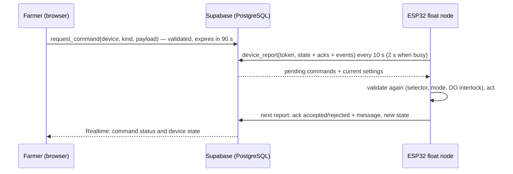

# Dashboard Application (APP) Specification

**Project:** Solar Automated LoRa-Integrated Mud Crab Aeration Network with Crab Grid Observation

The dashboard is a **React (Vite + TypeScript)** single-page app in [`web/`](../web/), hosted on
**Vercel**, with **Supabase** (PostgreSQL, Realtime, anonymous Auth) as the backend. It replaces the
earlier Next.js + Firebase design. The local selector on the box remains the fail-safe.

## 1. Access: QR code or typed code, no login page

1. Each float node has a sticker with a **QR code** and an **access code** (8 characters, e.g.
   `K7QM-3XRP`), made by `npm run provision` ([`SETUP.md`](SETUP.md)).
2. The QR opens `https://<site>/?code=K7QM-3XRP`; typing the code on the start page does the same.
   Case, spaces, dashes and O/I typed for 0/1 are tolerated.
3. The browser gets an **anonymous Supabase session** (no username or password), and
   `claim_device_access(code)` grants that session access to the device. The code is then removed from
   the address bar; the phone remembers the pond.
4. **The code opens the whole site, including control** (project decision: farmers should not have to
   remember credentials).

Security model and limitations:

| Point | Behaviour |
|-------|-----------|
| What the code is | A shared credential printed on the box. Anyone who can read or photograph the sticker can view **and control** the pond until the code is replaced |
| Guessing | 8 Crockford base-32 characters ≈ 1.1 × 10¹² codes; only the SHA-256 hash is stored |
| Revocation | `admin_rotate_access_code(device, new_code)` replaces the code and signs out every phone that used the old one; print a new sticker |
| What browsers can do | Read the claimed device's rows (RLS) and call `request_command` / `update_device_settings`, which validate everything. No table is directly writable |
| Device credential | Per-device token (hash stored), used only by the ESP32 with the public anon key; revoke with `admin_rotate_device_token` |
| Service-role key | Only on an admin computer for provisioning; never in the browser, Vercel or the ESP32 |
| Audit | Every command records the anonymous session id (`requested_by`) and times; settings record `updated_by` |
| Anonymous sign-ins | Must be enabled in Supabase Auth; consider enabling CAPTCHA protection there to limit automated sign-ups |

## 2. Pages

### Start page
Access-code entry (no password field), list of ponds saved on this phone, language switch.

### Water Quality Sensing (main tab)

| Card | Shows |
|------|-------|
| pH | Calibrated pH (2 dp), status, target 7.5–8.5, calibration badge, "approximate" note when temperature is faulted |
| Salinity | PSS-78 salinity (ppt, 1 dp), conductivity at temperature and EC25 (mS/cm), target salMin–salMax, EC calibration badge; explains *over range* (above the K = 1 probe's ≈ 11 ppt), *below range* (< 2 ppt) and *not available* |
| Water temperature | °C (1 dp), target 27–30 °C, second probe if present, "used to compensate pH, EC/salinity and DO". No calibration |
| Dissolved oxygen | mg/L (2 dp), ≥ 5 good / 3–5 warning / < 3 critical, DO calibration badge, DO-emergency notice |
| Ammonia toxicity | Emerson (1975) unionized NH₃ fraction (%), labelled as an estimated fraction, not a concentration; *not available* when pH or temperature is invalid |

Below the cards: operating mode, pumps and salinity correction, history charts (24 h / 7 d for all
five indicators with target bands; gaps where there was no valid reading), and recent events.

### Calibration
pH, salinity/EC (shows **K = 1**, standards, correction factors), dissolved oxygen (SEN0237-A; explains
that the DO9100 is a separate cross-check instrument), and ammonia-toxicity calculation information
(formula, source, assumptions — nothing to calibrate). Each calibratable section shows status,
version, when it was recorded, active values, the live session (stable/settling, captured points),
Start/Capture/Save/Cancel and the device's answer, and previous calibrations. Temperature has no
calibration section.

### Settings & Data
Salinity-correction settings (§6), history retention (keep everything, or delete after N days),
**Download all readings (CSV)** and **Download all events (CSV)**, device information.

## 3. Behaviour rules

- **Live / stale:** the device reports every 10 s. A report older than 45 s (by the server's clock)
  marks the whole page stale: last-known values stay visible, greyed and labelled, with a banner. The
  mode is shown as "last known", never as confirmed.
- **No false zeros:** a value is shown only for status `ok` or `degraded`; otherwise the card shows
  *Sensor fault*, *Over range*, *Not detected* or *Not available*. A real 0 is shown as 0.
- **Simulated data:** reports flagged `simulated` (from `npm run simulate`) show a red
  "SIMULATED DATA" banner, and CSV rows carry `simulated = true`.
- **Requested vs confirmed:** the mode panel shows the device's mode and, separately, the requested
  mode while a request is waiting. Every request shows *Sending… / Waiting for the device… / Done /
  Refused by the device: reason / Not delivered / No answer from the device*.
- **Realtime:** Supabase Realtime updates state, commands, events, settings and calibration records;
  if the subscription drops, the page refreshes every 30 s and says so.
- **Language:** English or Filipino, remembered per phone.

## 4. Data model (Supabase)

Migration: [`supabase/migrations/20261026000000_salimango_initial.sql`](../supabase/migrations/20261026000000_salimango_initial.sql).

| Table | Content | Written by |
|-------|---------|------------|
| `devices` | Name, active flag, hashes of access code and device token, access epoch | Admin functions |
| `device_access_grants` | Browser session ↔ device, with the access epoch | `claim_device_access` |
| `device_settings` | salMin/salMax/salHyst, bilge times and tries, retention, version | `update_device_settings` |
| `device_state` | Latest report: measurements (numeric, units in column names), statuses, mode, selector, relays K1/K5/K3/K4, bilge state, calibration (JSON), applied settings version | `device_report` |
| `readings` | History, at most one row per minute, with the calibration ids in force | `device_report` |
| `calibration_records` | One row per saved calibration (sensor, version, id, parameters) | `device_report` |
| `commands` | Requests with status pending → delivered → accepted/rejected, or expired/superseded | `request_command`, `device_report` |
| `events` | Device events (severity, kind, message) | `device_report` |

RPCs: browser — `claim_device_access`, `request_command`, `update_device_settings`, `server_time`;
device — `device_report`; admin (service role only) — `admin_register_device`,
`admin_rotate_access_code`, `admin_rotate_device_token`, `admin_set_device_active`.

Retention: `readings` rows older than `retention_days` are deleted during device reports when a window
is set; `NULL` (the default) keeps everything. Calibration records, events and commands are kept.

## 5. Command flow

A request the device never collects becomes *expired*; one it collected but did not answer is shown as
*No answer from the device* after its expiry.

## 6. Settings and validation

| Parameter | Default | Allowed | Unit | Used for |
|-----------|---------|---------|------|----------|
| `salMin` | 28 | 10–34 | ppt | AUTO bilge turns on below it (3 readings) |
| `salMax` | 32 | 10–34, > salMin | ppt | High-salinity warning on the dashboard |
| `salHyst` | 2.0 | 1.0–5.0 | ppt | Bilge stops at salMin + salHyst |
| `bilgeMaxRunMin` | 15 | 5–60 | min | Maximum run before a timeout |
| `bilgeMinOffMin` | 30 | 10–120 | min | Rest after a run |
| `bilgeMaxFails` | 3 | 1–10 | count | Timeouts in a row before lockout |
| `retention_days` | empty (keep all) | 7–3650 | days | History deletion |

The bilge values come from [`salinity_rev.md`](../salinity_rev.md) and are engineering starting values
to be tuned in bench tests. The same limits are enforced by the form, the database and the firmware.
With the K = 1 probe, salinity above ≈ 11 ppt is over range and counts as "not low".

Display targets (colours only; control is in the firmware): pH 7.5–8.5, temperature 27–30 °C, DO ≥ 5
mg/L (critical < 3) — SEAFDEC/AQD values in [`Components.md`](Components.md).

## 7. Safety interlocks

| Interlock | Where |
|-----------|-------|
| OFF needs a confirmation dialog, and `confirm: true` in the request | Dashboard + database + firmware |
| Selector at M or O overrides the dashboard; mode buttons are disabled with an explanation | Firmware + dashboard |
| Pumps switch only in MANUAL; buttons disabled otherwise and while data is stale | Firmware + dashboard |
| Air pumps cannot be switched off during a DO emergency | Firmware + dashboard |
| MANUAL returns to AUTO after 5 min without a command (countdown shown) | Firmware |
| Requests expire after 90 s | Database + firmware |
| Boot, reset or Wi-Fi loss never switch aeration off | Firmware |

## 8. CSV export

"Download all readings" exports every stored history row for the device (paged 1000 at a time), oldest
first: time (UTC, ISO 8601), sequence, simulated flag, mode, pH, EC, EC25, salinity, temperature, DO,
NH₃ fraction, each with its status, DO emergency, relays K1/K5/K3/K4, bilge state and calibration ids.
Empty cells mean "no value" (never zero). UTF-8 with BOM so Excel shows °C correctly.
"Download all events" exports time, severity, kind and message.

## 9. Code

| Path | Contents |
|------|----------|
| `web/src/App.tsx` | Session start, QR/typed-code access, saved ponds |
| `web/src/hooks/useDevice.ts` | Loading, Realtime, polling fallback, server clock, commands, settings |
| `web/src/components/` | Tabs, cards, mode/pump panels, charts, calibration, settings, export |
| `web/src/lib/` | Types, status rules, CSV/history, translations, Supabase client |
| `web/scripts/provision-device.mjs` | Device registration, sticker QR |
| `web/scripts/simulate-device.mjs` | Simulated device for development |
| `web/tests/` | Database (PGlite), library and UI tests |

## Deferred / removed from the previous design

- **Firebase** (Realtime Database, Auth, service-account env vars): replaced by Supabase.
- **Camera page** (ESP32-CAM-MB access point): removed with the camera.
- **LoRa**: in the previous design the house bridge polled the command queue and relayed commands over
  LoRa, with a heartbeat-loss alarm at the house after 90 s. Deferred; the commands, acks and state in
  §4–5 are transport-independent so a bridge can be added later.
