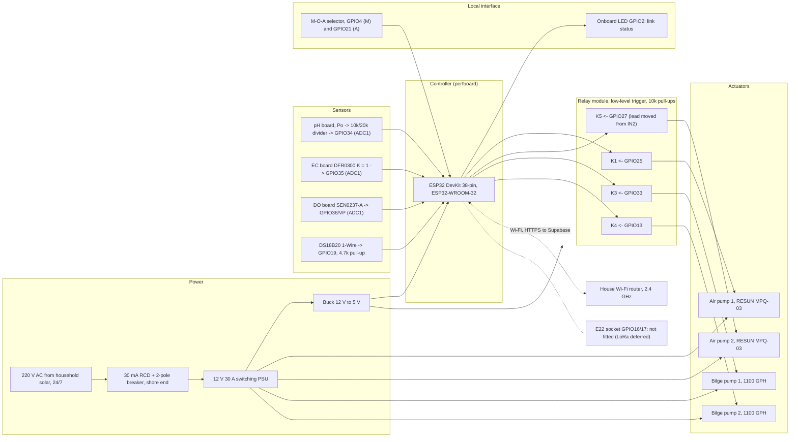

# Hardware Block Diagram

**Project:** Solar Automated LoRa-Integrated Mud Crab Aeration Network with Crab Grid Observation

Float-node hardware for the current phase. Pins follow
[`perfboard_build_guide.pdf`](../perfboard_build_guide.pdf) as listed in [`WIRING.md`](WIRING.md) §3.

## 1. Block diagram

**Figure 1.** Float-node hardware block diagram (current phase).

## 2. Block descriptions

| Block | Function | Key interfaces |
|-------|----------|----------------|
| Power | 220 V AC from the household solar system, shore-end RCD, 12 V PSU, 5 V buck | Electrician-installed AC; 12 V to the pumps through relays and fuses; 5 V to the ESP32 and relay module VCC |
| Controller | ESP32-WROOM-32 on the perfboard: sensing, calibration, control, Wi-Fi | Three ADC1 inputs, 1-Wire, four relay outputs, two selector inputs |
| Sensors | pH, EC (K = 1), DO, temperature | Analog on GPIO34/35/36 (ADC1, Wi-Fi-safe); DS18B20 on GPIO19 |
| Relay module | Low-level trigger; K1, K5, K3, K4 used (K2 defective) | 10 kΩ pull-ups keep relays off through reset |
| Actuators | Two RESUN MPQ-03 air pumps (switched together, 5 s apart), two 1100 GPH bilge pumps (2 s apart) | Branch-fused 12 V |
| Local interface | M-O-A selector (local authority), onboard LED | Active-LOW inputs on GPIO4/21 |
| Wi-Fi | House router | Must reach the float; 2.4 GHz |

## 3. Design notes

1. All analog inputs are on **ADC1**, which keeps working while Wi-Fi is on.
2. No load on a boot-strapping pin; GPIO0, 5, 12, 15 and UART0 (1/3) are unused.
3. Relay outputs are driven HIGH before initialisation and held off by pull-ups through reset; the
   firmware then turns the air pumps on (fail-safe aeration at boot).
4. The relay module is 5 V with 3.3 V logic inputs; confirm each relay is fully off with the input at
   3.3 V ([`WIRING.md`](WIRING.md) §6).

## Removed and deferred blocks

- **Camera node (ESP32-CAM-MB, OV2640)** and its 5 V USB module: removed in this phase.
- **LoRa radio (E22-900T22D) and house bridge node:** deferred; the perfboard's E22 socket stays empty.
