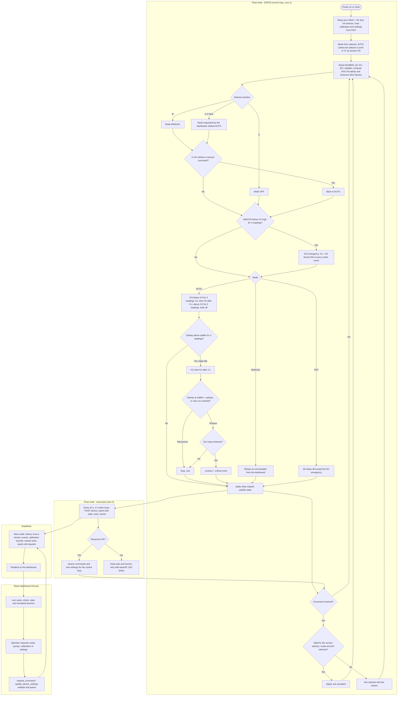

# System Flowchart

**Project:** Solar Automated LoRa-Integrated Mud Crab Aeration Network with Crab Grid Observation

One control cycle of the current phase: sensing and local control on the ESP32, the Wi-Fi report to
Supabase, and dashboard commands. Rules are detailed in [`FIRMWARE.md`](FIRMWARE.md) §2.

## 1. Flowchart

**Figure 1.** Operational flowchart of the current phase.

## 2. Flow description

1. **Boot.** Relays are held off during initialisation, then the air pumps start (fail-safe).
   Calibration and settings come from flash, so the node works without the network.
2. **Sensing.** Each reading is validated; a fault or out-of-range value is reported as such, never as
   a number. Salinity and the NH₃ fraction need a valid temperature.
3. **Mode.** The selector decides at M and O; at A the dashboard chooses. MANUAL returns to AUTO after
   5 minutes without a command.
4. **DO emergency.** Evaluated in every mode, before anything else.
5. **AUTO.** Aeration by DO; salinity correction by the `salinity_rev.md` state machine, evaluated
   independently of the DO branch.
6. **Commands.** Validated twice (database, then device) and acknowledged with a reason.
7. **Reporting.** A separate task sends the state; network problems never block the control loop.

## 3. Fail-safe notes

- Boot, reset and Wi-Fi loss never switch aeration off.
- A missing DO reading counts as low for AUTO aeration.
- The selector always overrides the dashboard at the device.
- Stale data on the dashboard is shown as stale; an old mode is never shown as confirmed.

The image `SYSTEM FLOWCHART SALIMANGO3.drawio.png` in the repository root shows the previous
(LoRa / camera) design and has not been updated.
