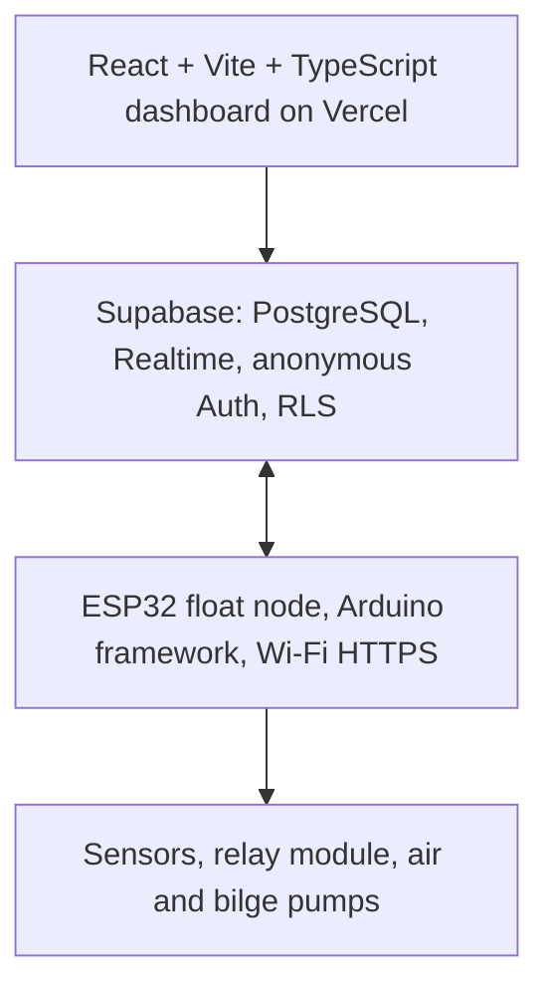

# Technology Stack

**Project:** Solar Automated LoRa-Integrated Mud Crab Aeration Network with Crab Grid Observation

Layer-by-layer reference for the current phase. Architecture: [`SYSTEM-ARCHITECTURE.md`](SYSTEM-ARCHITECTURE.md).

## 1. Stack at a glance

## 2. Hardware

| Layer | Component | Qty | Role |
|-------|-----------|-----|------|
| Controller | ESP32 DevKit 38-pin (ESP32-WROOM-32) on the perfboard | 1 (+ spare) | Sensing, control, Wi-Fi |
| Sensing | DFRobot DFR0300 EC (K = 1), E-201-C + PH-4502C pH, DFRobot SEN0237-A DO, DS18B20 | 1 each | Water quality |
| Actuation | 8-channel relay module (5 V, low-level trigger; K1/K5/K3/K4 used), 2 × RESUN MPQ-03 air pumps, 2 × 1100 GPH bilge pumps | 1 set | Aeration and salinity correction |
| Local control | INScom LW28-20A M-O-A selector | 1 | Local authority over the mode |
| Power | 220 V AC drop + 30 mA RCD, 12 V 30 A PSU, 12 V → 5 V buck | 1 set | Household-solar-fed power chain |
| Reference instruments | Refractometer, DO9100 handheld DO meter, reference thermometer | 1 each | Cross-checks (not connected) |

## 3. Firmware

| Technology | Purpose |
|------------|---------|
| Arduino framework, esp32 core 3.3.12 (Arduino IDE 2 or `arduino-cli`) | Build and runtime |
| FreeRTOS task (core 0) | Network I/O separate from the control loop |
| `OneWire` + `DallasTemperature` | DS18B20 |
| `ArduinoJson` 7 | Report and command JSON |
| `WiFi`, `HTTPClient`, `NetworkClientSecure` (built-in CA bundle) | HTTPS to Supabase |
| `Preferences` (NVS) | Calibration, settings |
| Project code `sensor_math.*`, `control_logic.*` | Formulas and control rules (host-testable C++) |

The DFRobot `DFRobot_EC` / `DFRobot_pH` libraries are **not** used; their conversions are reproduced
in `sensor_math.cpp` for the ESP32's ADC, as in the earlier bench sketches.

## 4. Backend

| Technology | Role |
|------------|------|
| Supabase PostgreSQL | Tables, constraints, history |
| PL/pgSQL `SECURITY DEFINER` functions | Device report, access claims, validated commands and settings |
| Row-level security | Browsers see only devices they claimed with a sticker code |
| Supabase Realtime | Live updates to the dashboard |
| Supabase anonymous Auth | A session per browser without a login page |
| `pgcrypto` / `sha256` | Hashing of access codes and device tokens |

## 5. Frontend

| Technology | Role |
|------------|------|
| React 19 + TypeScript | UI |
| Vite | Dev server and build |
| `@supabase/supabase-js` | Queries, RPCs, Realtime |
| Plain CSS, SVG charts | No UI or chart library |
| Vercel | Hosting (`web/vercel.json`) |

## 6. Development and test tools

| Tool | Use |
|------|-----|
| Vitest + Testing Library + jsdom | Dashboard tests |
| PGlite (PostgreSQL 18 in WASM) | Migration and security tests without a server |
| g++ (host) | Firmware math and control-logic tests |
| ESLint, TypeScript | Lint and type check |
| `npm run provision` / `npm run simulate` | Device provisioning, simulated device |
| Mermaid | Diagrams in these docs |

## 7. Explicit non-dependencies

1. **No Firebase** (replaced by Supabase).
2. **No camera** stack (removed).
3. **No LoRa** library or house bridge in this phase (deferred).
4. **No service-role key** in the browser, Vercel or the ESP32.
5. **No on-site solar panels, MPPT or battery**: power comes from the household's 24/7 solar-backed
   supply.
