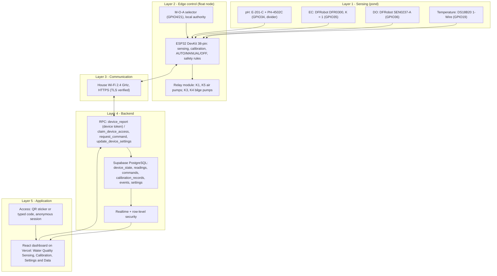

# System Architecture

**Project:** Solar Automated LoRa-Integrated Mud Crab Aeration Network with Crab Grid Observation

Current phase: **ESP32 sensors and actuators → Wi-Fi → Supabase → React dashboard.** One ESP32 on the
float joins the house Wi-Fi directly; there is no house bridge. LoRa is deferred and the camera is
removed.

## 1. Architecture decisions

| Area | Current-phase requirement |
|------|---------------------------|
| Frontend | React.js (Vite + TypeScript), hosted on Vercel |
| Backend | Supabase (PostgreSQL, Realtime, anonymous Auth, row-level security) |
| Communication | Direct ESP32 Wi-Fi (HTTPS to Supabase) |
| Separate house bridge | Not required |
| Camera | Removed |
| LoRa | Deferred |
| Website access | QR code or typable code (no username/password) |
| EC probe | DFRobot Analog EC (DFR0300), K = 1 |
| Pin assignments | Referenced against `perfboard_build_guide.pdf` |
| Calibration | Existing sensor-specific routines reused and persistently integrated |

## 2. Architecture diagram

**Figure 1.** Five-layer architecture of the current phase.

## 3. Layers

| Layer | Contents | Responsibility |
|-------|----------|----------------|
| 1 — Sensing | pH, EC (K = 1), DO, DS18B20 | Measurement at mid-depth on the centred hub |
| 2 — Edge control | ESP32, relay module, M-O-A selector | All control and safety decisions, calibration, validation; works without the network |
| 3 — Communication | House Wi-Fi, HTTPS | One report every 10 s (2 s while busy); commands and settings ride the response |
| 4 — Backend | Supabase | Storage, history, authorisation (device token, sticker-code grants, RLS), Realtime |
| 5 — Application | React on Vercel | Monitoring, control requests, calibration, settings, charts, CSV |

## 4. Data flows

| Flow | Path | Contents |
|------|------|----------|
| Telemetry | ESP32 → `device_report` → `device_state` (+ `readings` once a minute) → Realtime → dashboard | Measurements with status, derived salinity and NH₃ fraction, mode, selector, relays, bilge state, calibration state |
| Control | Dashboard → `request_command` → `commands` → next `device_report` response → ESP32 validates and acts → ack in the next report | `set_mode`, `set_relays`, `calibration`, `clear_bilge_lockout` |
| Calibration | Dashboard → `calibration` commands → ESP32 session → saved to NVS → reported → `calibration_records` | Parameters, version, id; history rows carry the id in force |
| Settings | Dashboard → `update_device_settings` → `device_settings` → `device_report` response → ESP32 validates, applies, stores in NVS → echoes `settings_version` | salMin, salMax, salHyst, bilge times and tries |
| Events | ESP32 → `device_report` → `events` → dashboard | Emergencies, lockouts, faults, mode changes, calibration |
| Access | QR / typed code → `claim_device_access` → `device_access_grants` → RLS | Per-browser grant, revoked by rotating the code |
| Local | Selector → ESP32 | M / O override everything remote; A lets the dashboard choose |

## 5. Design rationale

1. **Autonomy first.** The float must keep the crabs alive with no network: AUTO aeration, the DO
   emergency in every mode, MANUAL timeout and boot with aeration on all run on the ESP32.
2. **Requested ≠ confirmed.** Commands live in `commands`; what the device actually does lives in
   `device_state`. The dashboard shows both and never shows a stale mode as current.
3. **One source per rule.** Pins in `config.h`; formulas in `sensor_math.cpp`; derived values computed
   once on the device and stored, so the dashboard and CSV show what the controller used.
4. **Least privilege.** The browser and the ESP32 only use the public anon key; RLS and validating
   functions decide what they may read and do.
5. **Single points of failure are visible.** One DO probe (handheld cross-check), one AC drop, one
   Wi-Fi link: each failure shows on the dashboard as stale data or an event, and the float keeps
   running locally.

## Deferred: LoRa (future phase)

The previous architecture used a 915 MHz LoRa point-to-point link (EBYTE E22-900T22D) from the float to
a second ESP32 "house bridge" where Wi-Fi existed, which relayed to the cloud and raised a heartbeat-loss
alarm at the house. It remains a candidate for sites where the house Wi-Fi does not reach the float. The
firmware's `cloud.h` interface and the transport-independent database contract (§4) are the intended
extension points; the perfboard keeps the E22 socket on GPIO16/17.
